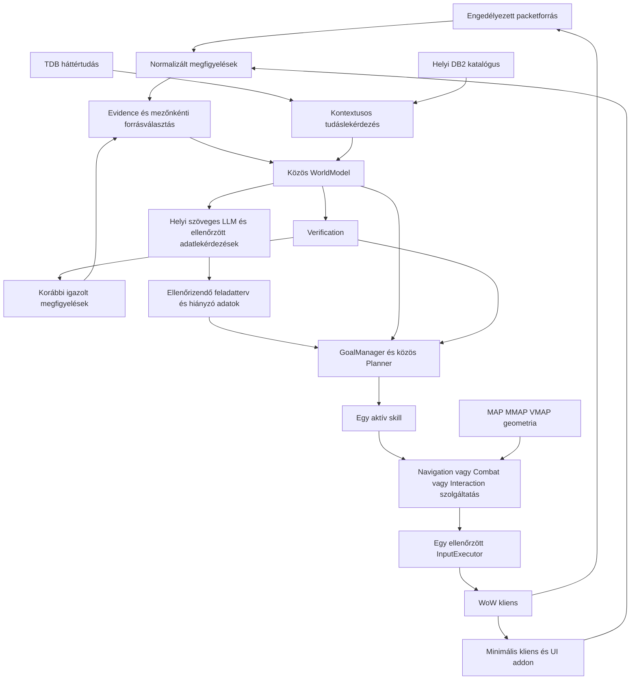
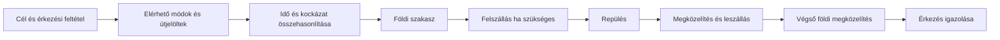

# Az agent tervezett végleges felépítése


## Forrásellenőrzött REV4 korrekció – olvasd el a régi fejezetek előtt

**Állapot:** a `src (2).zip` 498 Python-fájljának AST + statikus importgráf elemzése és a kritikus futási láncok forráshelyi ellenőrzése megtörtént. **Ez nem teljes függvényenkénti live audit**, és a ZIP nem tartalmazza a `tests/` fájlokat, a Lua addon producert vagy a natív Ymir producercsatornát. Az új célmodulok nem implementációk. A teljes új, pontos fájl→API→tulajdonos migrációs indoklás a `SRC_MELY_AUDIT_20261029_HU.md` dokumentumban van; a `SRC_498_MODUL_LELTAR_20261029.csv` csak statikus leltár.

**A legfontosabb új, kóddal alátámasztott döntések:**

1. A `navigation/flight_trip.py` és `flight_travel.py` **már be van kötve** a `navigation/global_planner.py:208–209` hívásba, ezért a travel redesign a működő mixed-flight út kiterjesztése, nem a nulláról új bekötés. A `flight_trip.TripPlan` még nem a végleges általános `TripLeg`-sorozat.
2. A `navigation/danger.py:100–175` és `spawn_threats.py` **már tartalmaz veszélyes mobkerülést**. A `RouteRiskEvaluator` az előrejelzett harcidő/HP-veszteség/aggro + flight/transition cost **új rétege**, ne második DangerMap legyen.
3. Az `agent/quest_graph.py:8–122` **már ismeri** az objective/quest dependency readiness-t; az új `QuestExecutionGraph` **belső mechanikalépéseket** ír le, nem lecseréli a questláncot. `quests/objective_mechanics.py` már aktív TDB/DB2 classifier, `agent/tdb_knowledge.py` fogyasztja.
4. `agent/engine.py:79–88` dinamikusan csatol nav oracle-okat WorldModelhez, és `tdb_locations.route_cost_oracle` **modulszintű globális metódushivatkozás**. Ezt explicit, példányonkénti porttá kell tenni a multi-PID izoláció érdekében.
5. `packetio/context.py:16–38` és `agent/runtime_packet_source.py:68–93` a mai packet bootstraphez addon-state-et követel; `agent/world.py:360–428` session ownershipja is az addon megfigyeléssel kapcsolódik össze. **Az addonmezőket addig nem lehet törölni**, amíg új bootstrap + field parity + input/UI regression nincs.
6. A fő `agent/runtime.py:356–362` **jelenleg is hívja a vizuális update-et**, a `skills/combat.py` és `agent/target_manager.py` is tartalmaz visual-track alapú logikát. A no-vision runtime csak consumer-szintű kivezetéssel készül el.
7. Az importgráf szerint `agent.models`-ra 196 modultól jön hivatkozás; egy 32-modulos import-SCC mutat erős összekapcsoltságot. **Előbb szerződések és átmeneti facade-ok, később a fájlmozgatás.**
8. `execution/command_dispatch.py` és `agent/executor.py` megtartja az **egyetlen input authorityt**, az ACK ≠ világállapot-siker elvet, a PID, foreground, bindings, watchdog védelmeket. Az új Travel/Combat/Quest modulok nem kerülhetik meg.

**Külön ellenőrzött source-különbségek:** `world_packet_reducer.py:677–740` még addonstate-ből egészíti ki a saját packetes pozíció-/instance- és mapkörnyezetet; a teljes packetes quest-POI-tárolóból a fogyasztóknak csak a turn-in blobokat teszi ki. A `danger.py:50–65` veszélyprovenance címe fix `ADDON_TELEMETRY`, ezért ezt mezőszinten javítani kell a risk-kalkuláció előtt. Ezekből önmagukban nem következik live hiba, de migráció előtti tesztesetek.

**Ajánlott függőségi ütemezés:** `P0 baseline/trace → P1 contracts + DI + oracle isolation → P2 session bootstrap → P3 addon/packet mező parity → P4 no-vision runtime → P5 leg-based Travel/Transition → P6 RouteRisk → P7 Combat + roles → P8 mechanic-based Quest → P9 legacy cleanup/LLM calibration`. A régebbi T0–T8 ütemeket nem szabad automatikusan késznek vagy ennek megfelelőnek tekinteni.

---

**Döntési terv, 2026. október 29., Europe/Budapest.**

## Aktuális felhasználói irány: szerveres adatút és addon

**A célarchitektúra két élő adatforrásra épül: ellenőrzött packetes játékállapot és az addon strukturált kliens/UI-telemetriája. Vizuális érzékelés nincs a tervezett működésben.** YOLO, OCR, World3D-képfelismerés, vizuális követés, kamera-/minimap-keresés, VLM és ezek passzív vagy hiba utáni fallback változatai kívül esnek a célon.

A V4/Design és a korábbi vizuális masterkövetelmények a felhasználó újabb döntése szerint elavult tervezési háttér. Nem írják elő vizuális modulok megtartását, és nem indokolnak rejtett vizuális függést a mozgásban, célzásban vagy ellenőrzésben. A melléklet régi számozott sorai csak történeti nyomkövetésként maradnak meg.

Az addonból származó `quest_ui.open`, látható gombkoordináta, aktív actionbar vagy F7-címzett strukturált adat; ezek használata nem igényel képfelismerést. Ha a meglévő AIPC-transport pixelcsíkon továbbítja az addon üzenetét, annak protokolldekódolása az addon adatcsatornájának része. Ebből nem következik játékvilágot vagy UI-elemeket felismerő képfeldolgozás. A szükséges csatorna külön működjön általános képernyő-, detektor- vagy tracker-feldolgozás nélkül.

A helyi DB2, MAP/MMAP/VMAP, tanult SQLite és opcionális TDB tudás-/geometriaforrás. Egyik sem vizuális érzékelő. A jelen módosítás csak a tervet igazítja ehhez az irányhoz; agentkódot és konfigurációt nem épít át.

## A tervezési alap felülvizsgálata

A felhasználó újabb észrevétele alapján a régi struktúrák megtartása nem önálló tervezési cél. Az előző változat túl szorosan kötötte a javaslatot az örökölt dokumentumok osztályaihoz és számozásához. A további döntést a jelenlegi cél, a ténylegesen működő adatút, a felhasználó frissebb iránya és a mérhető viselkedés alapján kell meghozni.

A fájlokban örökölt eltérés van: a munkamappa AGENTS.md-je a 0–82 mastert nevezi meg, míg a tényleges `projekt` AGENTS.md-je még a V4 és Design forrásokra hivatkozik. A felhasználó most a V4-et is elavultnak jelölte, és egyértelműen szerveres + addon működést kért. A régi fájlok ezért a korábbi döntések történeti forrásai; a célarchitektúra friss meghatározását a fenti felhasználói irány adja. [A projekt jelenlegi utasításai](<C:/Users/<user>/Documents/ChatGPT/ai_visual_bot_midnight claude/ai_visual_bot_midnight 1.2/projekt/AGENTS.md:4>) [A V4 eredeti célleírása](<C:/Users/<user>/Documents/ChatGPT/ai_visual_bot_midnight claude/ai_visual_bot_midnight 1.2/projekt/wow_agent_FINAL_M0_M1_master_prompt_v4.txt:12>)

A fő terv felelősségi bontása továbbra is indokolt javaslat, de az osztály- és modulnevek nem kötelező végállapotok. A „közös WorldModel” koherens, forrásos világképet jelent; nem kötelező egyetlen óriási state-dictionary. A „közös planner” összehangolt döntést jelent; lehetnek alatta külön célbontó, útvonal- és helyi mozgástervező algoritmusok, egyértelmű életciklussal. A konkrét `AutonomousAgent`, `NavigationService`, skill-wrapper és rétegfelosztás megtartásáról a kódminőség, a függőségek és a tesztelhetőség alapján kell majd dönteni. Egy meglévő osztály létezése önmagában nem érv a megtartása mellett.

Amit műszaki okból továbbra is szükségesnek tartok: egyértelmű állapottulajdon és forrásválasztás, összehangolt fizikai input, megfigyeléssel igazolt siker, megszakítható mozgás, valamint a hibák és bizonytalanság követhetősége. Az egyidejűleg ellentétes billentyűparancsokat kiadó végrehajtók problémája akkor is fennállna, ha az összes régi dokumentumot lecserélnénk.

A 0–82 és M0–M27 melléklet **örökölt követelmények nyomon követése**, nem az új terv kötelező fejezetstruktúrája vagy a teljes jelenlegi termék készültségének új értékelése. A későbbi megvalósítás előtt rövid, egységes, a mai célokra írt működési specifikáció szükséges, és ahhoz kell igazítani a projektutasításokat. A régi számozást nem kell új komponensekkel mesterségesen kitölteni. Ez a tervezési felülvizsgálat nem írja át automatikusan a projekt AGENTS.md-jét vagy biztonsági/inputjogosultságait, és nem indít új agent építését.

A javaslat a meglévő agent képességeiből indul ki: koherens világállapot és összehangolt döntés/végrehajtás; a szervertől ténylegesen megfigyelt állapot legyen az elsődleges a szerver által meghatározott mezőkben. A TDB háttértudást és keresési támpontokat adjon. Az addon a kliens helyi működéséhez szükséges adatokat szolgáltassa. A mozgás egy közös, több közlekedési módot kezelő szolgáltatás feladata legyen. Az alábbi konkrét modulmegőrzések ennek megvalósítási jelöltjei, a fenti felülvizsgálati feltétellel.

A felhasználó visszavonta az új agent/V2 megépítését. **Ez a dokumentum kizárólag terv: nincs új agent, kódátépítés, addontelepítés, konfigurációváltás vagy új live teszt.** Az itt javasolt nevek és adatszerződések tervezési fogalmak; nem elkészült komponensek.

## 1. Mit javaslok megtartani, és mit kell rendbe tenni?

Megtartanám a működő képességeket: a megfigyelés–világállapot–tervezés–végrehajtás–ellenőrzés láncát, a kiválasztott PID és binding-cache ellenőrzését, az összehangolt fizikai inputot, a packetek ellenőrzött normalizálását, a natív MMAP-útkeresést, a MAP/VMAP-adatokat, a meglévő földi és repülő végrehajtók használható részeit és a DB2-katalógust. A célfelépítésből a vizuális feldolgozás és minden hozzá tartozó runtime-függés kivezetendő. A forráskódban már létező `NavigationRequest`, `ArrivalEnvelope`, `GlobalRoute` és `LocalMotionPlan` szerződések jó kiindulópontok. A végleges szerződés illeszkedése fontosabb, mint minden jelenlegi típus változatlan megőrzése; a migráció végén egyértelmű API és tulajdonosi rend kell. [Közös agent](<C:/Users/<user>/Documents/ChatGPT/ai_visual_bot_midnight claude/ai_visual_bot_midnight 1.2/projekt/src/wowbot/agent/engine.py:59>) [Meglévő navigációs szerződések](<C:/Users/<user>/Documents/ChatGPT/ai_visual_bot_midnight claude/ai_visual_bot_midnight 1.2/projekt/src/wowbot/navigation/contracts.py:26>)

Az öt legfontosabb változtatás:

1. A mezőnkénti hiteles adatforrást közösen kell eldönteni. Jelenleg több fogyasztó saját sorrendben olvassa a live adatot, a TDB-t és a memóriát.
2. A packetes quest-, inventory-, spell- és párbeszédadatok feldolgozását ki kell egészíteni. A mai szűk eseménykészlet még nem helyettesíti az addon teljes állapotát.
3. A quest és a létező világobjektum közötti kapcsolatnak önálló, bizonyítható relációnak kell lennie. Az objektum helyének ismerete önmagában nem mondja meg, hogy azt ölni, használni vagy figyelni kell.
4. A MOVE-nak teljes utazást és valódi célba érést kell kezelnie, a felszállástól a végső földi megközelítésig.
5. A visszaellenőrzés, az újrapróbálás és a hibák hatóköre legyen egységes. Egy hibás hely ne tiltsa le az egész questet, és egy mozgásszakasz vége ne jelentsen questteljesítést.

## 2. Mit támaszt alá a jelenlegi kód?

A korábbi működési audit mellett újra feldolgoztam a tényleges `projekt/src` 497 Python-forrását, a quest- és mozgáslánc fontos pontjait, valamint az addon snapshotját és FAST-adatútját. A mellékletek 84 felső szintű snapshotmezőt, a FAST-utóhozzárendeléseket és 53 referencia/TDB-kapcsolatra utaló forrásfájlt sorolnak fel. A szöveges találatlista feltárási lista: kommentet és közvetett függést is tartalmaz, ezért nem 53 külön hibát jelent.

**Későbbi forrásfrissülés:** a tervezési alap felülvizsgálatakor kilenc korábban leltározott mozgási forrás hash-e már eltért, és megjelent a `navigation/flight_travel.py` adapter. A jelenlegi globális tervező ezen át már hívja a walk–fly–walk/A* utat, és a szolgáltatásban felszállóhely-megközelítési, illetve repülési folytatási ág is látszik. Az eredeti „nincs a futó MOVE-ba bekötve” megállapítás ezért meghaladott. Az alábbi mozgási tényeket ehhez igazítottam; az új bekötést ebben a munkában nem teszteltem és nem én implementáltam. [Időközben megjelent repülési adapter](<C:/Users/<user>/Documents/ChatGPT/ai_visual_bot_midnight claude/ai_visual_bot_midnight 1.2/projekt/src/wowbot/navigation/flight_travel.py:140>)

| Megfigyelés | Következmény |
|---|---|
| Az `ObjectiveLocator` a kiválasztott cél egyezése után a TDB-régiót vizsgálja, és csak utána az objective aktuális API-helyét. | Egy statikus régió megelőzhet frissebb helybizonyítékot. [ObjectiveLocator](<C:/Users/<user>/Documents/ChatGPT/ai_visual_bot_midnight claude/ai_visual_bot_midnight 1.2/projekt/src/wowbot/agent/objective_locator.py:23>) |
| A referencia-projekció neve továbbra is `TDB_PRIMARY_LIVE_VERIFIED` / `PRIMARY_STATIC`. | A statikus tudás kiemelt szerepe beépült az adatútba; egy címke átnevezése ezt nem javítja meg. [Referencia-projekció](<C:/Users/<user>/Documents/ChatGPT/ai_visual_bot_midnight claude/ai_visual_bot_midnight 1.2/projekt/src/wowbot/agent/reference_knowledge.py:221>) |
| A szerver mód a képernyős keresés és célzás engedélyezését is szabályozza. | A szerver mód kiválasztása önmagában nem minden adatmezőre érvényes prioritásrendszer. [Szerver mód](<C:/Users/<user>/Documents/ChatGPT/ai_visual_bot_midnight claude/ai_visual_bot_midnight 1.2/projekt/src/wowbot/agent/server_mode.py:42>) [Planner szűrése](<C:/Users/<user>/Documents/ChatGPT/ai_visual_bot_midnight claude/ai_visual_bot_midnight 1.2/projekt/src/wowbot/agent/planner.py:509>) |
| A packetforrás kontextusát az `addon_context` hozza létre; saját mozgás és térképmezők projekciója is kapcsolódik az addon állapotához. | Az addon nagy részének egyszerű törlése megszakíthatja a packetes adatút indulását is. [Packetforrás kontextusa](<C:/Users/<user>/Documents/ChatGPT/ai_visual_bot_midnight claude/ai_visual_bot_midnight 1.2/projekt/src/wowbot/agent/runtime_packet_source.py:68>) [Packetes állapotprojekció](<C:/Users/<user>/Documents/ChatGPT/ai_visual_bot_midnight claude/ai_visual_bot_midnight 1.2/projekt/src/wowbot/agent/world_packet_reducer.py:677>) |
| Jelenleg 22 normalizált packetes eseménytípus van az allowlistben, köztük diagnosztikai típusok is. | Ez nem 22 teljes funkcionalitás; például a teljes questdefiníció és inventory baseline hiányzik ebből a felületből. [Packetes allowlist](<C:/Users/<user>/Documents/ChatGPT/ai_visual_bot_midnight claude/ai_visual_bot_midnight 1.2/projekt/src/wowbot/packetio/validation.py:7>) |
| A reducer megőrzi a teljes packetes quest-POI-t, de a fogyasztók számára itt csak a leadási blobokat vetíti ki. | A többi objective-geometriát is lekérdezhetővé kell tenni, pontos hozzárendeléssel. [POI-projekció korlátja](<C:/Users/<user>/Documents/ChatGPT/ai_visual_bot_midnight claude/ai_visual_bot_midnight 1.2/projekt/src/wowbot/agent/world_packet_reducer.py:709>) |
| A friss turn-in resolver már előnyben részesít aktuális szerveres NPC-t és leadási POI-t; statikus adat külön magasságtámpontként is szerepelhet. | Ezt a javulást meg kell tartani; nem igaz, hogy most mindenhol a TDB nyer. [Aktuális leadási resolver](<C:/Users/<user>/Documents/ChatGPT/ai_visual_bot_midnight claude/ai_visual_bot_midnight 1.2/projekt/src/wowbot/agent/turnin_resolver.py:71>) |
| A globális tervező friss változata `flight_travel.plan_travel_flight` útján már beköti a `flight_trip` / `flight_planner` láncot; a régi terrain-profile út feltételes fallbackként marad. | A bekötés már létezik; a teljes életciklus és viselkedés igazolása külön feladat. [Futó repülési tervhívás](<C:/Users/<user>/Documents/ChatGPT/ai_visual_bot_midnight claude/ai_visual_bot_midnight 1.2/projekt/src/wowbot/navigation/global_planner.py:165>) [Meglévő teljes utazástervező](<C:/Users/<user>/Documents/ChatGPT/ai_visual_bot_midnight claude/ai_visual_bot_midnight 1.2/projekt/src/wowbot/navigation/flight_trip.py:98>) |
| Az új adapter oldalirányú A*-útvonalat alakít a repülési vezérlő tervévé, a korábbi folyosó is megmarad. | Ez továbbra sem általános, teljes háromdimenziós ütközésvizsgálat. [Használt repülési folyosó](<C:/Users/<user>/Documents/ChatGPT/ai_visual_bot_midnight claude/ai_visual_bot_midnight 1.2/projekt/src/wowbot/navigation/flight_route.py:262>) |
| A travel policy távolság- és magasságküszöbökkel választ repülést; az általános mountválasztás Skyridingra teljesebb, mint Steady Flight-ra. | A sima repülés végrehajtója és a minden helyzetben működő módválasztás eltérő készültségű. [Közlekedési mód választása](<C:/Users/<user>/Documents/ChatGPT/ai_visual_bot_midnight claude/ai_visual_bot_midnight 1.2/projekt/src/wowbot/agent/travel_mode.py:103>) |

A korábbi audit 306 célzott offline tesztje előzmény. A jelen tervezési munkában nem futtattam új agenttesztet, és a tervezett adatforrásváltást vagy repülést nem nyilvánítom ezek alapján validáltnak. A projekt friss coverage-ledgere további, más munkából származó eredményeket is tartalmaz; azok saját bizonyítéka és hatóköre érvényes. [Meglévő coverage-ledger](<C:/Users/<user>/Documents/ChatGPT/ai_visual_bot_midnight claude/ai_visual_bot_midnight 1.2/projekt/docs/CURRENT_SOURCE_COVERAGE.md:1>)

## 3. A szerveroldali adatok és a TDB kapcsolata

A felvetésed jó irány: amit a kliens ténylegesen megkap a szervertől, azt a packetes adatútból közvetlenül is fel lehet építeni, ha az adott üzenet értelmezése ellenőrzött. Nem szükséges ehhez előbb SQL-t gyártani, azt egy TDB-be betölteni, majd ugyanazt az állapotot visszaolvasni.

A teljes TDB azonban több, mint egyetlen játékos packetjeinek másolata. Egyes questmezők és relációk valóban sniffelhetők; más adatok történeti gyűjtések, más karakterek megfigyelései vagy a szerver implementációjához tartozó kiegészítések. A TrinityCore forrásában a `quest_template_addon` külön custom adatrész, egyes mezői kifejezetten nem sniffelt/WDB adatként szerepelnek. A teljes lootvalószínűségi táblát vagy a szerver teljes belső scriptjét nem szabad egy megfigyelt eseményből levezetett ténynek nevezni. [TrinityCore questdefiníció](https://github.com/TrinityCore/TrinityCore/blob/master/src/server/game/Quests/QuestDef.h)

A WPP dokumentációja szerint a world adatbázis az SQL-különbségek előállítását is segíti, a WPP saját adatbázisa pedig például névfeloldási adatokat adhat. Következésképpen a WPP szöveges kimenetében megjelenő feloldott név nem automatikusan az adott packetben elküldött mező. A tervezett adatút külön kezelje a packetből kiolvasott és a referencia-adatbázisból hozzáadott adatot. [WPP adatbázis-használat](https://github.com/TrinityCore/WowPacketParser#databases)

A helyi WPP 12.x moduljában van quest-query, questdetails, reward, gossip, loot és spell feldolgozás. Ezek használható protokollreferenciák. **A parser létezése nem jelenti, hogy a mi aktuális buildünk payloadja, eseménysémája, reducerje és plannerfogyasztója már igazolt.** [Helyi WPP quest-query](<C:/Users/<user>/Documents/ChatGPT/ai_visual_bot_midnight claude/ai_visual_bot_midnight 1.2/projekt/native/WowPacketParser/WowPacketParserModule.V12_0_0_65390/Parsers/QueryHandler.cs:14>) [Helyi WPP questdetails](<C:/Users/<user>/Documents/ChatGPT/ai_visual_bot_midnight claude/ai_visual_bot_midnight 1.2/projekt/native/WowPacketParser/WowPacketParserModule.V12_0_0_65390/Parsers/QuestHandler.cs:66>) [Helyi WPP loot](<C:/Users/<user>/Documents/ChatGPT/ai_visual_bot_midnight claude/ai_visual_bot_midnight 1.2/projekt/native/WowPacketParser/WowPacketParserModule.V12_0_0_65390/Parsers/LootHandler.cs:21>)

## 4. A célarchitektúra egy adatútban



A packetes réteg és az addon megfigyelést ad; egyik sem választ questet vagy nyom billentyűt. A TDB/DB2 lekérdezése sem ad közvetlen végrehajtási jogot. A domain réteg leírja a feladatot, a közös planner választ képességet, az aktív skill a szolgáltatáson keresztül dolgozik. A különböző mozgásmódok ugyanazon mozgásszolgáltatás belső képességei. A döntési és ellenőrzési láncnak vizuális megfigyelés nélkül teljesnek kell lennie.

## 5. Melyik forrás miben legyen hiteles?

Nem elég egyetlen általános `SERVER > ADDON > TDB` lista. Egy szerveres NPC-koordináta, egy kliensoldali kattintási pont és egy DB2 spellkúp három külön kérdésre válaszol.

| Adat | Elsődleges forrás a célállapotban | Más forrás szerepe |
|---|---|---|
| Jelenlegi NPC/objektum GUID, létrejött/eltűnt állapot, megfigyelt XYZ, per-player használhatósági flag | Ellenőrzött szerverüzenet és objektuméletciklus | TDB csak lehetséges korábbi spawn, memória történeti hely |
| Saját mozgás XYZ/facing/pitch/sebesség | Kiválasztott kliens ellenőrzött mozgáseseménye, külön irány- és bizonyítékjelöléssel | Szerverkorrekció erősebb; addon csak külön megjelölt, átmeneti segédadat |
| Questdefiníció, objective ID/type/object ID/required, szerver által küldött questszöveg | Aktuális build ellenőrzött questválaszai | TDB a még nem megfigyelt mezőket egészítheti ki |
| Elfogadás, progress, teljesítés, leadás | Az adott életciklushoz kötött szerverállapot és megfelelő esemény | Nyitott UI vagy elküldött gombnyomás csak köztes bizonyíték |
| Aktuális inventory és lootforrás | Saját inventory/container és lootüzenetek, egyértelmű tranzakciókapcsolattal | TDB a még nem megfigyelt itemforrás kereséséhez |
| Aktív actionbar oldal, makró/override helyi feloldás, a billentyű tényleges kliensoldali jelentése | Kliens UI/addon + kifejezetten kiválasztott binding-cache | Packetes actionbutton-adat kiegészítés lehet, nem helyettesíti a helyi kiosztás igazolását |
| F7/soft-interact címzett, mouseover, kurzor, nyitott táska és látható UI-gomb koordinátája | Kliens UI/addon | A packet legfeljebb a később végrehajtott interakciót igazolhatja |
| Terrain, járható folyosó, épületfelület | Verziózott helyi MAP/MMAP/VMAP | A szerver aktuális objektumai dinamikus korlátozásokat adnak |
| Spellalakzat, radius, kliensjelenet erőforrása/útvonala | Ellenőrzött helyi DB2/kliensadat | A szerver mondhatja meg, mely scene vagy spell aktív |
| Nem látott NPC lehetséges helye, ismeretlen itemforrás, questlánc jelöltje | Történeti memória vagy TDB hipotézisként | A végrehajtás előtt live bizonyíték szükséges |

Különösen fontos: a jelenlegi `PACKET_CLIENT_MOVEMENT` a saját kliens által jelentett mozgás. Ez a hálózaton megfigyelt pozíció hasznos visszacsatolás, de nem automatikusan szerver által már elfogadott állapot. A tervezett modell külön `CLIENT_TO_SERVER` és `SERVER_TO_CLIENT` eredetet, illetve korrekciót tartson fenn. [Packetes állapotprojekció](<C:/Users/<user>/Documents/ChatGPT/ai_visual_bot_midnight claude/ai_visual_bot_midnight 1.2/projekt/src/wowbot/agent/world_packet_reducer.py:677>)

A forrásválasztás **ugyanarra az objektumra, mezőre és kontextusra** vonatkozzon. Egy távoli questhez tartozó szerveres mob létezése ne tiltsa le egy másik, közelebbi quest indokolt TDB-alapú keresését. Az eltérő questek közötti sorrendet továbbra is a planner költség-, kockázat- és felhasználói prioritása határozza meg.

## 6. A bizonyíték és a frissesség tervezett szerződése

Minden döntést befolyásoló tényhez tartozzon: alany, mező/reláció, érték, forrás, eseményazonosító, kiválasztott PID, karakter, kapcsolat/session-korszak, map/instance és ismert phase-kontextus; továbbá megfigyelési idő, beérkezési idő, build/layout, teljesség és érvényességi ok.

Az érvényesség nem minden mezőnél egyszerű másodperces TTL. A pozíciómintának szigorú korhatára kell; egy változatlan, szerver által létrehozott álló objektum addig is ismert maradhat, amíg az életciklusa és a stream folytonossága ezt indokolja. A packetek csendje önmagában nem új állapot. Kimaradás, mapváltás, despawn, új session vagy streamrés külön invalidálást igényel.

A több forrásban megjelenő ugyanazon információ nem több független bizonyíték. A packetből származó, SQL-be importált, majd visszaolvasott hely ugyanannak a megfigyelésnek a leszármazottja. A forrásláncot meg kell őrizni, különben a rendszer saját adatait többszörös megerősítésként számolja.

A hiányzó mező maradjon `UNKNOWN`; üres vagy csonkolt lista ne jelentsen „nincs ilyen objektum”. A részleges snapshot jelezze, mely területre és meddig teljes. Ellentmondó magasság vagy célazonosság esetén a planner ne kapjon összegyúrt, látszólag biztos koordinátát.

## 7. Packetes adatút: milyen sorrendben érdemes bővíteni?

| Csomag | Új szemantikai képesség | Mi váltható ki vele? | Mai korlát |
|---|---|---|---|
| P0 | Addontól független, ellenőrzött PID/build/saját karakter/map kontextus, baseline és streamfolytonosság | Az addon kötelező bootstrap-szerepe | Ma `addon_context`-függés van |
| P1 | Questdefiníció és objective-azonosítók; questlog baseline és delta | A live objective-k TDB-függő azonosítása és az addon questlogjának nagy része | Ma főként credit/update/complete jellegű események vannak |
| P2 | Questdetails, aktuális offer/menu, request-items, reward és leadási életciklus | Starter/ender relációk, párbeszéd tartalma, egyes chain-tippek | A kliens UI tényleges láthatósága külön adat marad |
| P3 | Név/template feloldás, objektumhoz adott objective ID, teljesebb own-player/unit és class/spec állapot | TDB névfeloldás és egyes objektum–quest összekötések; helyes karakterprofil | A jelenlegi create/unit dekódolás csak vizsgált részhalmaz |
| P4 | Saját inventory/container baseline+delta, loot source/content, item változás | Addon inventory üzleti adatai; tanult itemforrások | Egyetlen drop nem teljes lootlista |
| P5 | Own/enemy cast start/update/go/stop/channel/interrupt eredmény, cooldown/charge/aura, hozzáférhető veszély-életciklus és mozgásjogosultság | Addon combat/spell/mount adatainak további része; gyors castreakció és ismert AoE kitérése | Pontos build, cél/castpéldány, alakzat és mezőszemantika külön bizonyítandó |
| P6 | Teljes quest-POI lekérdezés objective-szinten, scene kontextus és trigger korreláció | TDB helykeresés egy része, kézi quest–scene összekötések egy része | Nem minden triggerhez és questhez van XYZ a hálózaton |

A P0 minden későbbi adatforrásváltás előfeltétele. P1–P2 után már sokkal tisztább questvégrehajtás lehetséges; nem kell megvárni minden harci packet dekódolását.

Minden típusnál ugyanaz az elfogadási lánc: opcode az aktuális buildre ellenőrizve → payload szerkezete és határai ellenőrizve → szűk normalizált séma → identity/context/freshness reducer → WorldModel-lekérdezés → létező plannerfogyasztó → offline hibaesetek → felhasználó által végzett live próba. Egy felismert opcodenevet nem szabad kész képességként kezelni.

A jelenlegi validátor általában nem enged szabad packetes szöveget. A questleíráshoz ezért célzott, hossz- és mezőkorlátos questszöveg-séma kellene, nem egy általános „bármilyen string megengedett” kivétel. Chat, személyes és hitelesítési tartalom továbbra sem kerülhet az agentbe. [Packetes allowlist](<C:/Users/<user>/Documents/ChatGPT/ai_visual_bot_midnight claude/ai_visual_bot_midnight 1.2/projekt/src/wowbot/packetio/validation.py:7>)

A terv nem bővíti a capture-jogosultságokat, nem ír elő új process-memory hozzáférést vagy közvetlen packetküldést. A jelenleg engedélyezett capture-határokon belül csak megfigyelt, ellenőrzött szemantikai eseményeket használna. Az Interface 120100, az aktuális process-build, az engedélyezett capture-bináris pinje, az opcode-tábla és a payload-layout külön kompatibilitási feltétel; egyik egyezése nem igazolja automatikusan a többit. A terv egyiket sem cseréli le.

## 8. Indulás és újraindulás addon nélkül

A legfontosabb különbség az agent újraindulása és a capture teljesen hideg indulása között van. Ha a már futó forrás birtokában van a saját karakter és az aktív objektumok aktuális baseline-ja, a GUI/agent újraindulásakor azt ugyanabban a kontextusban átadhatja. Ez nem jelenti a régi pozícióminták idejének átírását.

Ha a capture később indul, a kliens pedig korábban cache-elte a questleírásokat vagy inventory-állapotot, azok nem biztos, hogy újra megjelennek a megfigyelt streamben. A hálózati protokollban létező mező sem garantáltan elérhető az adott pillanatban.

A tervezett folyamat:

1. A kifejezetten kiválasztott PID és támogatott build ellenőrzése.
2. Saját karakter és világkontextus megállapítása ellenőrzött eseményekből; az önazonosság nem névhasonlóság.
3. Forrásképesség-állapot: például `world_entities=READY`, `quest_log=NO_BASELINE`, `inventory=PARTIAL`, `ui=READY`.
4. Baseline és utána rendezett delták; duplikációk eldobása, rés észlelése, epoch-váltáskor régi élő állapot invalidálása.
5. Csak azok a skillek válnak elérhetővé, amelyek bemenő adatai ténylegesen elegendők.

Szigorú packetes módban hiányzó baseline esetén az érintett feladat vár vagy konkrét hiányt jelent. A protokolladatok későbbi természetes újraküldése és az engedélyezett kliens/UI-műveletek segíthetnek; tetszőleges hálózati lekérést nem tervezek. Az átállás alatt az addon quest/inventory baseline-ja ideiglenes, nyíltan jelölt pótlás lehet. **Végleges packetforrásra váltásig ez nem nevezhető addonfüggetlen funkciónak.**

## 9. Az addon végleges szerepe

A végállapotban az addon maradó felelőssége a kliens helyi megfigyelése. A teljes mai exportot mezőnként kell felbontani; a `target`, `inventory`, `quest_ui` és `actionbar` összetett mezők esetében csak a szerverről valóban megszerezhető rész költözik át.

Megtartandó helyi adatok:

- Aktív bar/page/override/vehicle/Skyriding kontextus, lokális action–slot–binding kapcsolat, makrók tényleges helyi feloldásához szükséges publikus adat.
- Soft-interact és soft-target címzett, mouseover, aktuális UI-célzás; a következő F7 megnyomás címzettje a gombnyomás előtti feltétel.
- Billentyűzetfókusz, inputot blokkoló menü, nyitott ablak, loading/cinematic UI, látható gomb, táska- és reward-választó koordináta.
- Addonból kapott látható UI-gombok, ablakok és szükséges kattintási pontok. Kamera-/nameplate-geometria és minimapképből származó célpont nem része a mozgásnak vagy célzásnak.
- Olyan publikus, a kliens által helyben számolt usability/range/mount-availability adat, amelynek megbízható megfelelője a megfigyelt hálózatból és az engedélyezett statikus adatokból nem állítható elő.
- A minimális addoncsatorna verziója, sorszáma, mintavételi ideje és életjele.

Átköltöztetendő adatok a megfelelő packetes kapu után: questdefiníció/progress, inventory item/count, szerveres egységállapot, szerveres világpozíció, loot- és spelltranzakciók, párbeszéd szerver által küldött tartalma. A szerverről csak részben megfigyelt adat nem kerülhet át pusztán azért, mert a neve „server”.

Pythonba helyezendő származtatások: quest-digest, quest-state revision, killed-corpses történet, összesített harci hint és tanult relációk. Ezeket ne az addon tartsa második WorldModelként. A `quest_turn_in_receipts` kiváltásához előbb a valódi leadási állapot packetes igazolása kell; a questlogból eltűnés önmagában abandon is lehet.

Az addon eseményvezérelt maradjon, kategóriánként frissítéssel és szükség szerinti rövid snapshottal. A FAST csatornán csak a gyors döntéshez szükséges, frissen mért UI- és actionbar-adat menjen. A képfelismerési címkézéshez vagy vizuális követéshez készült exportmezők kivezetendők; a strukturált addon/UI-megfigyelés megmarad. Titkos/hozzáférhetetlen API-érték `UNKNOWN` marad; a terv nem ad felhatalmazást annak kikerülésére.

A részletes, minden snapshotmezőt tartalmazó döntési tábla a mellékletben van. [Addon snapshotmezők](<C:/Users/<user>/Documents/ChatGPT/ai_visual_bot_midnight claude/ai_visual_bot_midnight 1.2/projekt/addon/AIPlayerControllerExport/AIPlayerControllerExport.lua:2481>) [Addon FAST producer](<C:/Users/<user>/Documents/ChatGPT/ai_visual_bot_midnight claude/ai_visual_bot_midnight 1.2/projekt/addon/AIPlayerControllerExport/AIPlayerControllerExport.lua:3034>) [Publikus itemhasználhatóság](<C:/Users/<user>/Documents/ChatGPT/ai_visual_bot_midnight claude/ai_visual_bot_midnight 1.2/projekt/addon/AIPlayerControllerExport/AIPlayerControllerExport.lua:2170>)

## 10. A binding-cache és a Skyriding actionbar szétválasztása

A binding-cache azt mondja meg, hogy egy fizikai billentyű milyen kliensakcióhoz van kötve. Nem azt, hogy ugyanazon actionbarhelyen minden helyzetben ugyanaz a spell van. A végleges modellben külön objektum legyen a fizikai binding és a pillanatnyi tartalom.

Például a kiválasztott cache szerint egy billentyű `ACTIONBUTTON1`. Normál baron az adott slot harci spell, Skyriding override alatt más képesség lehet. Az aktiválás feltétele ezért: ugyanaz a kiválasztott PID/cache → friss aktív bar és revision → aktuális slot/spell → használhatóság → binding → végrehajtás. Régi normál bar tartalmával nem szabad az új kontextust letiltani vagy más képességet aktiválni.

A barváltás érvénytelenítse a régi spell–slot feloldást; az érvényes fizikai bindingot nem kell emiatt eldobni. Ha a kellő akcióhoz nincs igazolt binding vagy helyi UI-aktiválási út, a képesség `UNAVAILABLE` indokot kap. Fallback billentyűt kitalálni továbbra sem szabad.

## 11. A TDB-függések cseréje funkciónként

| Mai erős TDB-szerep | Tervezett elsődleges adatút | Mi marad TDB-ben? |
|---|---|---|
| Quest objective azonosítása, target-entry és szükséges darabszám | Ellenőrzött quest-query/objective definíció + aktív log/progress | Még nem megfigyelt definíció ellenőrizendő mezői |
| NPC/GO szerepének összekötése az objective-val | Objective object ID; szerveres GO objective ID; questdetails/gossip/credit kapcsolatok | Scriptben közvetetten kiosztott proxy-credit kapcsolata, ha másból nem bizonyítható |
| Keresési régió, spawnhely, floor | Aktuális szerverentitás, objective-POI és helyes maptranszformáció | A nem látott világ történeti régiója; külön forrással magasságtámpont |
| Starter/ender és questfolytatás | Aktuális questlista/menu, details/reward küldője és igazolt elfogadás/leadás | Ismeretlen következő quest és még nem látott feladó keresési jelöltje |
| Tárgyat dobó mob/objektum | Loot source GUID + loot tartalom + inventory/progress összerendelés | Első drop előtti ismert itemforrások, több forrás jelöltje |
| Item–spell–credit és mechanika | Szerveres spell/credit tranzakció, helyi DB2 item/spell alakzat, tanult kontextusos kapcsolat | Nem megfigyelt feltételes script/SmartAI összeköttetés |
| Jármű, escort, beszélgetés, emote mechanika | Aktuális questszöveg + szerveres állapotváltozás + kliens UI + általános mechanism-adapter | Előzetes mechanikahipotézis és hiányzó szereplőkapcsolat |
| Statikus veszélytérkép | Élő szerveres hostile/target/attack/reach állapot | Nem megfigyelt terület becsült veszélye, külön „potenciális” rétegként |

A `reference_knowledge` jelenlegi összetett felületét kompatibilis átmenettel kell rendezni. Először mezőnkénti, forrásos lekérdezés kell, utána a fogyasztókat átállítani; nem kell egyszerre minden modult átírni. A TDB-adapter, a DB2-adapter és a tanult tudás közös tudáslekérdezési felület mögött maradhat. A fogyasztó a kapott adat hitelességét és alkalmazhatóságát ellenőrzi, nem a fájlnév alapján dönt.

A részletes függőségi melléklet a talált 53 fájlt egyenként csoportosítja. Az import/GUI-fájlok adminisztratív részek; a resolverek és a questmodel valódi viselkedési kapcsolatok. [TDB-adapter](<C:/Users/<user>/Documents/ChatGPT/ai_visual_bot_midnight claude/ai_visual_bot_midnight 1.2/projekt/src/wowbot/agent/tdb_knowledge.py:46>) [Actor/credit összekötések](<C:/Users/<user>/Documents/ChatGPT/ai_visual_bot_midnight claude/ai_visual_bot_midnight 1.2/projekt/src/wowbot/agent/packet_entity_facts.py:147>) [Questmodel referencia-kiegészítése](<C:/Users/<user>/Documents/ChatGPT/ai_visual_bot_midnight claude/ai_visual_bot_midnight 1.2/projekt/src/wowbot/agent/quest_model.py:376>)

## 12. Mikor kérhet az agent mégis TDB-adatot?

A TDB-t megtartanám opcionális kiegészítőként. A lekérdezés mondja meg, **milyen mező hiányzik és mihez kell**: `UNKNOWN_ITEM_SOURCE`, `NO_OBSERVED_ENDER`, `UNSEEN_SEARCH_REGION`, `UNRESOLVED_CREDIT_PROXY`, `SCENE_RELATION_UNRESOLVED` vagy más pontos ok.

TDB-válasz alapján szabad egy kontextusos keresési régiót vagy mechanikahipotézist létrehozni. Az ottani NPC létezését, az aktuális questelérhetőséget, az item használhatóságát vagy a kész objective-ot már megfigyelésnek kell igazolnia. A jelenlegi `confirmed=False`, `navigation_trusted=False` jelölések fontos különbséget őriznek; ezt nem szabad elveszíteni. [Statikus helyjelölt szerződése](<C:/Users/<user>/Documents/ChatGPT/ai_visual_bot_midnight claude/ai_visual_bot_midnight 1.2/projekt/src/wowbot/agent/tdb_locations.py:92>)

Az első meghiúsult keresés ne írja át az egész TDB-t. Tároljuk: mely karakter/quest/fáziskontextusban, melyik régiót, mekkora lefedettséggel, mikor és milyen eredménnyel kerestük. Ismeretlen phase esetén a találat hiánya különösen gyenge negatív bizonyíték.

A tervezett próbákhoz külön kapcsolható legyen a TDB olvasása és a szerveres inputmód. A `server_mode` a megengedett érzékelési/aktiválási politika; a `tdb_enabled` az opcionális tudásforrás. Ezek ne legyenek összekeverve. TDB nélküli módban a hiányzó tudás maradjon látható hiány, és ne töltődjön vissza rejtetten egy korábbi `reference_knowledge` snapshotból.

## 13. Saját SQLite: mit tároljunk benne?

A meglévő tanult világmemóriára építenék. A jelenlegi `tdb_learned.sqlite3` és importút használható részeit megtartanám, de különválasztanám az élő megfigyelést, a történeti tudást és a TDB-ből származó kiegészítést. A TDB-séma hasznos kompatibilitási kimenet lehet; a központi tudás jelentését ne az emulátoros táblák szabják meg. [Meglévő tanult világadatok](<C:/Users/<user>/Documents/ChatGPT/ai_visual_bot_midnight claude/ai_visual_bot_midnight 1.2/projekt/src/wowbot/agent/learned_world.py:1>) [Dumpimport a tanult világba](<C:/Users/<user>/Documents/ChatGPT/ai_visual_bot_midnight claude/ai_visual_bot_midnight 1.2/projekt/src/wowbot/agent/pkt_dump_import.py:1>)

A tervezett logikai adatkörök:

- Aktuális baseline/checkpoint: saját kontextus, stream epoch, sorszám, típusonkénti teljesség. Újraindításhoz, nem bizonyítatlan „frissítéshez”.
- Questdefiníció és objective ID/type/object ID/text/required, builddel és nyelvvel verziózva.
- Megfigyelt NPC/GO template, név és spawnelőzmény; a GUID-esemény és a template külön.
- Quest–NPC szerep, objective–actor–item–spell–scene reláció, bizonyíték- és feltételkapcsolattal.
- Lootforrás-megfigyelések; pozitív előfordulás, nem kitalált teljes dropráta.
- Keresési látogatások, sikeres/hibás mozgásszakaszok, floor/entrance/transzport kapcsolatok.
- Rövid életű, normalizált eseménynapló és kompakt hosszú távú összegzés; retentionnel és indexekkel.

Egy lehetséges rekord: „az adott quest/objective aktív állapotában az X entryjú, Y GUID-es mob lootablakából Z itemet kaptunk, majd a megfelelő számláló nőtt”. A tartós eredmény a kapcsolódó eseményazonosítókra hivatkozik; később új karakteren jelölt tudásként felhasználható. Az előző karakter sikerét nem lehet a mostani objective kész állapotaként visszatölteni.

A mai Ymir-dump → WPP → TDB import maradhat külön archiváló/feldolgozó folyamat. A futó planner friss állapota közvetlenül a normalizált eseményekből épüljön, ne az import végétől függjön. Az írás kötegelt, aszinkron és korlátos legyen; a gyors vezérlési ciklus ne olvasson nagy SQLite-történetet.

## 14. A questek általános megoldása

A QuestDomain feladata: felépíteni az aktív objective-k jelentését, a függőségeket, a lehetséges mechanikákat és a sikerfeltételeket. A közös plannernek olyan szándékot adjon, mint „szerezd meg ezt az itemet”, „beszélj ezzel a szereplővel”, „aktiváld ezt a célra irányított készüléket” vagy „haladj át ezeken a feltételes checkpointokon”.

A mechanikához tartozzon: bemenő bizonyíték, hiányzó adat, megengedett skill, célazonosság, hely-/alakzatkényszer, várható megfigyelés, sikerkritérium és korlátos hibakezelés. A jelenlegi `objective_mechanics` és playbookok használható kategóriái megmaradnak, de a TDB-s ténygyűjtő mellé live és tanult provider kell. A classifier létezése önmagában nem jelent kész végrehajtó támogatást; például escort, emote és speciális események külön készültségét meg kell őrizni. [Mechanikafajták és készültségük](<C:/Users/<user>/Documents/ChatGPT/ai_visual_bot_midnight claude/ai_visual_bot_midnight 1.2/projekt/src/wowbot/quests/objective_mechanics.py:79>) [Meglévő questplaybookok](<C:/Users/<user>/Documents/ChatGPT/ai_visual_bot_midnight claude/ai_visual_bot_midnight 1.2/projekt/src/wowbot/agent/quest_playbooks.py:1>)

A skyriding-lecke/race adapter a quest domainben maradjon. Ez a szétválasztás a `quests/scene_path_planning.py` modulban részben már megvan, és megtartandó. Ott kell eldönteni, mely scene-hez és feltételhez mely checkpoint tartozik, és mi ad valódi creditet. A navigáció csak a geometriai/fizikai megoldást kapja. A repülésvezérlőben nem szerepelhet „ha ez a quest ID, nyomj kétszer Space-t” logika. [Meglévő quest scene-adapter](<C:/Users/<user>/Documents/ChatGPT/ai_visual_bot_midnight claude/ai_visual_bot_midnight 1.2/projekt/src/wowbot/quests/scene_path_planning.py:37>)

A saját helyi DB2 SQLite-katalógus is már létezik; nem kell újra a nulláról felépíteni. A `ClientCatalog` helyi olvasó, online fallback nélkül. A quest–spell/SmartAI–scene–path resolver explicit adatkapcsolatokat és feltételes táblákat követ, és nem futtatja az importált Lua-kódot. A kézzel felülvizsgált questkötés, a build-time referenciajelölt és az aktuális scene-ből egyértelműen kiválasztott pálya külön bizonyítékszint. Az általános összekötés bővítendő, de nem minden scriptelt questhez létezik teljes, statikusan kiolvasható XYZ-út. [Helyi kliensadat-katalógus](<C:/Users/<user>/Documents/ChatGPT/ai_visual_bot_midnight claude/ai_visual_bot_midnight 1.2/projekt/src/wowbot/quests/client_catalog.py:17>) [Strukturális scene-feloldó](<C:/Users/<user>/Documents/ChatGPT/ai_visual_bot_midnight claude/ai_visual_bot_midnight 1.2/projekt/src/wowbot/quests/scene_resolver.py:1>)

A technikai credit entry nem feltétlenül a fizikailag létező megölendő mob. A játékszöveg „slain” vagy egy számláló creature-azonosítója nem bizonyítja önmagában a harci mechanikát. A beszélgetéssel, spellclickkel és itemhasználattal szerzett credit ugyanazon modell külön mechanizmusa legyen.

### 14/A. Elfogadott irány: helyi LLM mint questértelmező és feladattervező

A felhasználó elfogadta a helyi LLM magas szintű értelmező/tervező szerepét. Ez a célarchitektúra tervezett része, a konkrét implementáció továbbra is későbbi feladat. Szöveges és strukturált szerveres/addon/tudástári bemenetet kap, képi bemenet nélkül.

| Szerep | Tervezett eredmény |
|---|---|
| Questértelmezés | Az objective szövegéből mechanikajelölt: például célra irányított item, beszélgetés, kísérés vagy esemény kivárása |
| Többlépéses feladatbontás | Lépések, függőségek és előfeltételek; például gyengítés → itemhasználat → kísérés |
| Gossip/item/képesség értelmezése | A ténylegesen kapott opciók és képességek közül indokolt jelölt, a megadott azonosítókra hivatkozva |
| Elakadás elemzése | A következő indokolt adatlekérdezés vagy megengedett tervváltozat, megfigyelt hibák alapján |
| Korábbi siker újrafelhasználása | Igazolt megoldási epizódból feltételes mechanikajelölt egy hasonló feladathoz |

A közös döntési lánc engedélyezett, korlátos, csak olvasó lekérdezéseket adhatna a modellnek: aktuális quest/objective kontextus, ismert itemforrások, elérhető mechanikák és skillek, friss céljelöltek, korábbi hibák és igazolt hasonló megoldások. A lekérdezések a már kialakított providerfelületet használják, forrás- és teljességjelöléssel. A modell nem küld nyers SQL-t, inputparancsot vagy hálózati játéküzenetet. Ollama eszközhívási és JSON-séma támogatása alkalmas technikai alap; a kimenet jelentését továbbra is az agent ellenőrzi. [Eszközhívások](https://docs.ollama.com/capabilities/tool-calling), [strukturált válasz](https://docs.ollama.com/capabilities/structured-outputs).

A tervezett válaszszerződés tartalmazza a mechanizmust, lépéseket/függőségeket, a bemenetből vett objective/actor/item/candidate referenciákat, felhasznált evidence-azonosítókat, előfeltételeket, sikerfeltételeket és hiányzó adatokat. Kimeneti sémakövetés önmagában nem jelent igaz állítást. A program ellenőrzi a referenciák létezését, a terv végrehajthatóságát és az aktuális kontextust; a modellel becsült bizonyosság nem írja felül a forrásbizonyítékot.

A működés aszinkron, eseményvezérelt és gyorsítótárazott. Új/eldöntetlen objective, érdemi mechanikai változás vagy elakadás indokolhat kérdést; a folyamatos mozgásminták önmagukban nem. Egy értelmezési válasz a szöveg/definíció verziójához, egy operatív terv az aktuális quest/goal/actor kontextushoz kötődik. Végrehajtás előtt minden lépést újra ellenőrizni kell. Idő-, kontextus-, lekérdezés- és várakozási keret korlátozza a háttérmunkát.

A helyi modell a szöveg jelentését és a magas szintű feladatsorrendet kezeli. A pontos kormányzás, facing, felszállás/leszállás, harci időzítés és billentyűhasználat a determinisztikus végrehajtóké. Egy ismeretlen lootforrás, gyűrűkoordináta vagy scriptkapcsolat a modell tudásától nem válik igazolt ténnyé. Ha az LLM nem elérhető vagy hibás választ ad, az ismert mechanikák tovább működhetnek; a csak általa feloldható részfeladat vár vagy `UNRESOLVED` marad.

A kódban már létező `SemanticAdvisor` aszinkron quest-/képességszöveg-értelmezése és cache-e felhasználható alap. A külön `OllamaReasoner` jelöltrangsoroló szerepét ezzel össze kell rendezni: egyértelműen ugyanahhoz a döntési lánchoz tartozzanak, ismétlődő lekérdezések és párhuzamos végrehajtási authority nélkül. A mai kód nem teljes általános LLM-feladattervező; az új eszközfelület és tervszerződés tervezett munka. [Meglévő helyi szöveges értelmező](<C:/Users/<user>/Documents/ChatGPT/ai_visual_bot_midnight claude/ai_visual_bot_midnight 1.2/projekt/src/wowbot/agent/semantic_advisor.py:409>)

### 14/B. Combat: karakterhez illő játék, megszakítás, kitérés és talentek

A felhasználó új harci elvárásai a célarchitektúra részei. A [részletes combat-, karakterprofil- és talentterv](<C:/Users/<user>/Documents/ChatGPT/ai_visual_bot_midnight 1.2/output/server_first_proposal_20261029/COMBAT_ES_KARAKTER_TERV_20261029_HU.md>) külön dokumentumban tartalmazza a feltételeket, a mai adathiányokat és az elfogadási próbákat. A jelen munka ezek implementációját nem kezdi el.

| Követelmény | Tervezett működés |
|---|---|
| Saját karakter ismerete | Class/spec, szint, aktuális forma/stance, pet, erőforrások, ismert spellek, talentek és elérhető binding alapján képesség- és harci profil |
| Megfelelő harcmodor | Meleevel közelharci távolság, caster/ranged profillal megfelelő range és castablak; mixed/hibrid spec és pet tényleges állapota számít |
| Rogue stealth és speciális állapotok | Igazolt stealth/forma után megfelelő opener/képesség; nincs idő előtti autoattack vagy feltételezett állapotváltás |
| Enemy cast/channel figyelése | Releváns casterek konkrét castpéldánya, időablaka, szakíthatósága és ismert célja; nem csak a kiválasztott target |
| Megszakítás/kontroll | Például Pummel és Storm Bolt eltérő interrupt/CC előfeltételekkel; aktuális spell, cooldown, binding, range, immunitás és időben elérhető reakció |
| AoE/frontal/egyéb elkerülhető támadás | Megfigyelt tér-időbeli veszély alapján járható, időben elérhető kitérés; másra célzott támadás is számít, ha minket érint |
| Automatikus talentkiosztás | Szintlépés, pontváltozás és belépés után megfelelő class/spec/build szerinti szabad pontok kiosztása biztonságos állapotban, normál addon/UI úton és valódi configellenőrzéssel |

A castreakció és kimozgás a gyors vezérlő része. Az LLM előzetes értelmezést és magas szintű tervet adhat; a harc nem vár rá. A kitérés, targetkövetés és sebző rotáció közös inputtulajdont és rendezett folytatást igényel. A már kiosztott talentek resetje/specváltás külön konfigurációs döntés; a most kért funkció az elérhető szabad pontokat használja a megfelelő build szerint.

Minden class/spec támogatását külön kell igazolni. A hiányzó enemy cast/hazard adat, talent/UI provider vagy buildprofil látható készültségi hiány marad; egy képességnév vagy LLM-javaslat nem bizonyítja a működést. Kizárólag képi telegraphból felismerhető veszélyhez nincs garantált kitérés a szerveres + addon célban.

## 15. A MOVE legnagyobb szerkezeti hiánya

A mozgásláncban már van globális út, helyi vezérlő, floor-kezelés, arrival-verification, repülés és helyreállítás. A gond nem az, hogy mindent ki kell dobni. Az a hiány, hogy a módválasztás, az útvonal, a repülési fázis és a feladat valódi befejezése több helyen, eltérő részletességgel jelenik meg.

Ma a repülési szándékot például `flight`, `flight_style`, `flight_path`, landing- és relaunch-mezők viszik. A travel policy küszöbökkel módosítja a javaslatot; a globális tervező és a controller további döntéseket hoz. A meglévő elemeket egyetlen utazási terv és fáziséletciklus köré kell rendezni. [Közlekedési mód választása](<C:/Users/<user>/Documents/ChatGPT/ai_visual_bot_midnight claude/ai_visual_bot_midnight 1.2/projekt/src/wowbot/agent/travel_mode.py:103>) [Futó repülési tervhívás](<C:/Users/<user>/Documents/ChatGPT/ai_visual_bot_midnight claude/ai_visual_bot_midnight 1.2/projekt/src/wowbot/navigation/global_planner.py:165>) [Közös NavigationService](<C:/Users/<user>/Documents/ChatGPT/ai_visual_bot_midnight claude/ai_visual_bot_midnight 1.2/projekt/src/wowbot/navigation/service.py:39>) [Meglévő földi vezérlő](<C:/Users/<user>/Documents/ChatGPT/ai_visual_bot_midnight claude/ai_visual_bot_midnight 1.2/projekt/src/wowbot/agent/movement_controller.py:75>)

A repülő mount tulajdonsága és a jelenlegi mozgásállapot külön fogalom:

- **Képesség:** van-e engedélyezett földi mozgás, sima repülés, Skyriding, úszás vagy járműves képesség?
- **Állapot:** most a földön áll, jár, levegőben van, esik, taxi/jármű utasa, gyökerezett vagy átmeneti állapotban van?
- **Szakasz:** a terv most földi utat, felszállást, repülést, megközelítést vagy földi végső ráállást kíván?

Ha egy repülő mounton ülünk a földön, attól a földi út továbbra is érvényes. A rövid vagy beltéri utazás nem igényel felszállást. Ha már levegőben vagyunk, a közeli NPC-hez érkezéshez is biztonságos leszállási terv kell.

## 16. A közös navigációs kérés és a célba érés szerződése

A jelenlegi `NavigationRequest` bővüljön, ne legyen mellette új, konkurens MOVE-kérés. A kérés tartalmazza:

| Rész | Jelentés |
|---|---|
| Célreferencia | GUID/entry, pont, régió, irányított célfelület, checkpoint vagy transition; bizonyítékazonosítókkal |
| Koordinátakontextus | Világ/map/instance és UI-map külön; world yards és normalizált térkép külön; floor ismert vagy bizonytalan |
| Feladatkapcsolat | Goal/quest/objective/correlation ID; az aktuális cél maradjon stabil a szakaszváltáskor |
| Módok és korlátok | Csak ténylegesen elérhető walk/ride/steady/skyriding; harc-, folyadék-, indoor- és inputfeltételek |
| Érkezési feltétel | Távolság, magasság/floor, földet érés, sebesség, facing, interact-recipiens vagy checkpoint áthaladás |
| Érvényesség | Forráskorszak, célrevizió, route/geometry-verzió és megszakítási okok |

Az érkezés célfüggő. Egy régió felderítéséhez elég a megadott régióba érni. Egy NPC-nél megfelelő floor, távolság, facing, kezelhető sebesség és az interakciós szerződésnek megfelelő címzett kell. Egy gyűrűnél a haladás iránya és az áthaladási feltétel számít; nem kell megállni a közepén. Egy kúpos itemnél a megfelelő távolság és irányított hatás alakzata kell.

A `MOVE` sikere ezután is csak a mozgási cél teljesülése. Az `INTERACT` sikere a megfelelő interakció, a quest sikere pedig a megfelelő szerveres objective- vagy leadási állapot. Három külön eredmény és bizonyíték legyen, egymáshoz rendelve.

## 17. A teljes utazási terv



A földi-only terv közvetlenül a végső megközelítéshez vezet; nem kell végigjárnia az összes repülési fázist. Egy már airborne karakter a hozzá illő fázisból indul. A szakaszok tervezett közös fogalma: kezdő- és végállapot, geometriai folyosó, szükséges képesség, várható progress, lejárat/invalidation és eredmény.

A belső állapotgép például `PLANNING → GROUND_APPROACH → TAKEOFF → CRUISE → APPROACH → LANDING → GROUND_FINAL → ARRIVAL_VERIFY`, külön `RECOVERING`, `CANCELED`, `FAILED` ágakkal. Nem minden utazás használ minden állapotot. Egy szakaszváltás nem indít új questet, és nem nullázza a teljes utazás bizonyítékait.

Érvényes felszállóhelyhez a jelenlegi földi pontról járható út és megfelelő szabad tér kell. Érvényes leszállóhelyhez szabad megközelítés, a kért floorhoz tartozó felület, megfelelő méretű megállási tartomány és — ha a célhoz gyalogolni kell — tényleges földi összeköttetés kell. „A közelében van MMAP” nem bizonyítja, hogy onnan az NPC elérhető.

A meglévő `flight_trip.open_sky_spot` és `plan_trip` ebből már megvalósít részeket. A felülvizsgálatkor a `flight_travel` adapteren keresztüli globális bekötés már látszik a kódban. A következő ellenőrzés tárgya ezért a kért floor, a geometriai ismeretlenség, az időkorlát és a teljes szakaszátmenet szerződésének következetessége. A forrásbeli bekötés önmagában nem bizonyítja a sikeres felszállást, leszállást és végső NPC-interakciót. [Meglévő teljes utazástervező](<C:/Users/<user>/Documents/ChatGPT/ai_visual_bot_midnight claude/ai_visual_bot_midnight 1.2/projekt/src/wowbot/navigation/flight_trip.py:98>)

## 18. Mikor érje meg repülni?

Az általános döntés a teljes utazás várható idejét és kockázatát hasonlítsa össze:

```text
földi terv költsége = útidő + akadály/harc kockázata + korábbi hibák
repülő terv költsége = felszállóhely megközelítése + mount/felszállás
                    + repülés + leszállás + végső séta
                    + energia- és geometriai kockázat
```

A merev távolságküszöb helyett ez legyen az elsődleges döntés. Ésszerű biztonsági határok és módváltási hiszterézis továbbra is kellenek: pár yard mozgás miatt ne mountoljon fel-le, kis sebességingadozástól ne tervezze újra a teljes útvonalat. A paraméterek legyenek közös, naplózható policyben, mért útidőkkel kalibrálva, ne questenként külön számmal.

Példák:

- Közel levő NPC, azonos járható floor, már földön ülünk: gyalog vagy földi mountmozgással odamegyünk.
- Nagy távolság, nyitott környezet, elérhető flight és teljes leszállási terv: repülő jelölt összehasonlítása a földi úttal.
- Kevés XY, nagy magasságkülönbség: először megvizsgáljuk a lépcső/rámpa útját és a repülő jelöltet; az XY-távolság önmagában nem dönt.
- Barlang vagy tető alatti cél: alkalmas külső leszállóhely és bejáraton át vezető földi út; cél fölött lebegni nem megoldás.
- Skyriding energiahiány: a képesség és a helyzet alapján földi út, regeneráció vagy más igazolt mód; a planner nem feltételezi, hogy a sima repülésre váltás biztosan rendelkezésre áll.

A Steady Flight és Skyriding külön kezelési modell, de ugyanahhoz a célhoz tervez alternatívát. A módválasztás csak tényleges tulajdon, területi jogosultság, jelenlegi mountállapot és igazolt aktiválás mellett adhat repülést.

## 19. Mire használjuk a MAP, MMAP és VMAP állományokat?

| Adat | Tervezett szerep | Mire nem elég önmagában? |
|---|---|---|
| MAP | Terrainmagasság, lyuk, folyadék, felszín és nagyobb domborzat | NPC/quest szerep, épület teljes geometriája, aktuális ajtóállapot |
| MMAP | Járható poligonok, összefüggő floor, földi út, felszálló/leszállóhely földi kapcsolata | Teljes légifolyosó, élő akadályok, használható F7-cél |
| VMAP | Modellfelületek, tető/híd/épület magassága; a most megírt olvasó képessége szerint | A mai vertikális felületlekérdezés nem általános szabad 3D swept-volume collision/LOS |
| Élő packetes objektumok | Dinamikus célpont, ajtó/objektum állapotának megfigyelt része, ellenség és veszély | A teljes nem látott világ geometriája |

A szerver packetek általában nem helyettesítik a kliens teljes terep- és ütközési adatait. A statikus navigációs állományok megtartása ezért teljesen összeegyeztethető a szerveralapú agenttel.

A `WorldGeometryService` legyen a közös geometriaszolgáltató. A lekérdezés különböztesse meg a „nincs megfelelő felület/út”, „hiányzó tile”, „eltérő verzió”, „részleges út” és „nem támogatott geometriai teszt” eredményt. Ismeretlen adatból nem szabad szabad teret csinálni. A VMAP jelenlegi vertikális lekérdezéséből nem következik egy vízszintes sziklafal vagy oldalirányú repülési szakasz biztonsága. [Közös geometria](<C:/Users/<user>/Documents/ChatGPT/ai_visual_bot_midnight claude/ai_visual_bot_midnight 1.2/projekt/src/wowbot/world_geometry/service.py:22>) [VMAP jelenlegi felületlekérdezése](<C:/Users/<user>/Documents/ChatGPT/ai_visual_bot_midnight claude/ai_visual_bot_midnight 1.2/projekt/src/wowbot/world_geometry/vmaps.py:127>)

A mapazonosítóknál három külön dolog lehet a UI-map, a szerver világ/instance és a kivont adatkészlet tile-azonosítója. A már létező ellenőrzött feloldást meg kell őrizni, build-/dataset-provenance-szal. Új számszerű alias találgatása nem fogadható el.

## 20. A földi navigáció célállapota

A globális út a natív MMAP-keresésből és a kontextusos topológiából jön. A helyi vezérlő ennek járható folyosóját követi, előretekintő célponttal; nem tetszőlegesen ugrál a waypointok között. Kanyarlevágás és útvonal-simítás csak ellenőrzött járhatóság mellett megengedett.

A mozgó cél referenciája a GUID marad, nem egy régen kimásolt XYZ. Kis célmozgás a helyi utolsó szakaszt frissíti; jelentős eltérés, floor/mapváltás vagy érvénytelen út új globális tervezést kér. A cél föld alá/másik floorra vetítése nem javítandó tetszőleges Z-cserével.

A részleges MMAP-út csak egy részszakasz célja lehet. A végső cél még nem teljesült; a tervnek meg kell mondania, mi az utolsó ismert pont után következő felderítés vagy transition. Ha ez hiányzik, pontos okkal megáll. Ezt az arrival-verifierben is következetesen érvényesíteni kell.

A stuck állapotot az út menti előrehaladás, az elvárt mozgás, a saját pozíció frissessége és az aktuális floor együtt adja. A körbejárás lehet nagy megtett távolság nulla célirányú progresszel. Helyi akadály, hiányos adat és hibás cél külön hibakategória legyen; nem mindegyikhez ugrás vagy oldalazás a megoldás.

## 21. A repüléstervezés célállapota

Első ütemben két dolgot kell egységes szerződésként igazolni: a teljes walk–fly–walk utazás tervezését, illetve az útvonalvariánsok összehasonlítását. A frissebb forrásban a közös bekötés már megkezdődött. A meglévő magasságprofil és az oldalirányú, több magasságot vizsgáló A* jó alapok, de az utóbbi is korlátozott, magassági síkokon dolgozó kereső. Nem szabad kész, minden akadályt kezelő 3D navigátornak nevezni. [Használt repülési folyosó](<C:/Users/<user>/Documents/ChatGPT/ai_visual_bot_midnight claude/ai_visual_bot_midnight 1.2/projekt/src/wowbot/navigation/flight_route.py:262>) [Meglévő magassági A*](<C:/Users/<user>/Documents/ChatGPT/ai_visual_bot_midnight claude/ai_visual_bot_midnight 1.2/projekt/src/wowbot/navigation/flight_planner.py:279>)

A tervező legalább a következő jelölteket hasonlítsa össze a rendelkezésre álló geometriával: közvetlen folyosó, oldalirányú kerülő és magasabb átrepülés. A szükséges szabad teret a karakter/mount mérete és a követési bizonytalanság növelje. A végső megközelítés és a leszállófelület ugyanannak a jelöltnek a része legyen.

A teljes megbízható akadályvizsgálathoz később valódi szakasz-/térfogat-ütközési szolgáltatás kellene a helyi adatokból. Amíg ez nincs, csak a ténylegesen ellenőrzött, megfelelő lefedettségű szabadtéri folyosók legyenek vállalhatók. A hiányt külön képességhiányként kell jelenteni; nem indok az összes működő navigáció újraírására.

**Steady Flight:** rövid előretekintés, magasság-/heading-/sebességhiba korrigálása; a függőleges mozgás és a leszállás mérhető feedbackből történjen. A landinghez magasság, alacsony vertikális sebesség és tényleges földet érés kell; az NPC XY-ja fölött lenni nem elég.

**Skyriding:** sebesség, függőleges mozgás, fordulás és elérhető energia is korlátozza a követhető pályát. Nem elég egy pont felé fordulni, ha a sebesség mellett az a kanyar nem repülhető. A waypoint-sorhoz simított, korlátos fordulású megközelítés és előre tervezett energiahasználat kell. A boost csak az aktuális aktív baron igazolt képességből, elegendő állapottal és értelmes repülési célból aktiválható.

A kezdeti megoldás lehet korlátos előretekintő szabályozás és mért fordulási/emelkedési modell; nem szükséges rögtön nagy MPC/RL rendszer. A mai Skyriding vezérlőben már van `_predict`, `_inside_turn_circle` és feltételes boostválasztás; a Steady vezérlő is külön friss packetes magasságot figyel. Ezeket meg kell tartani, és a teljes utazási tervhez illeszteni. A modell bizonytalansága növelje a biztonsági tartalékot. A dupla Space vagy az emelkedő képesség aktiválása csak felszállási kísérlet: sikerét növekvő magasság/airborne és megfelelő mozgásállapot igazolja. Ha nincs igazolás, a rendszer ne menjen tovább „cruise” állapotba. [Meglévő Steady vezérlő](<C:/Users/<user>/Documents/ChatGPT/ai_visual_bot_midnight claude/ai_visual_bot_midnight 1.2/projekt/src/wowbot/agent/flight_control.py:45>) [Meglévő Skyriding vezérlő](<C:/Users/<user>/Documents/ChatGPT/ai_visual_bot_midnight claude/ai_visual_bot_midnight 1.2/projekt/src/wowbot/agent/skyriding_control.py:78>)

A gyors vezérlő a beállított, véges élettartamú mozgásparancsot kezeli; nem futtat nehéz A*-t. A drágább globális tervezés megszakítható háttérfeladat, a közös vezérlő csak a még aktuális request/context/geometry revision eredményét fogadhatja el. A mai 40 Hz-es kontroll és 3 Hz-es közepes ciklus használható kiinduló felosztás, nem igazolt teljesítménygarancia. [Runtime ciklusfelosztás](<C:/Users/<user>/Documents/ChatGPT/ai_visual_bot_midnight claude/ai_visual_bot_midnight 1.2/projekt/src/wowbot/agent/runtime.py:222>)

## 22. Három korábbi probléma a tervezett rendszerben

### Blackrock Weapon: mi köti az orcot a tárgyhoz?

Az objective item ID-ja és a mob entryje külön adat. Ha nincs közvetlen questjelölés, az agentnek itemforrás-reláció kell. Ezt adhatja korábbi igazolt saját lootmegfigyelés vagy TDB-jelölt; a mob élő helyét és támadhatóságát a szerverállapot adja. A névszövegek eltérése nem szakíthatja meg az item–forrás kapcsolatot.

Az első lootnál a forrás-GUID, az item és a megfelelő objective-progress korrelációja tanult kapcsolatot adhat. Más item vagy másik egyidejű objective nem erősítheti meg véletlenül. TDB nélkül, első találkozáskor és semmilyen jelölés/tapasztalat nélkül a biztos dropforrás nem garantálható: célzott információszerzés kell, nem véletlenszerű harci agresszió.

### Vineyard: miért nem F7-tel oltunk tüzet?

A tűzre irányított készülék mechanikája eltér a tárgyinterakciótól. Kell az aktív questhez tartozó item, annak aktiválási módja, a DB2 szerinti célzási/periodikus/kúpos hatás, egy értelmes tűzcél, megfelelő távolság/facing és megfigyelt credit. Az F7-recipient hiánya ebben a mechanikában nem ugyanaz, mint a készülék használhatatlansága.

A meglévő directed-item javítás használható alap. Ma a feltételes TDB spell-hit–credit összekötés még fontos szerepet játszik; ennek kiváltásához megfigyelt spell/credit kapcsolat vagy más egyértelmű adat kell. A DB2-geometria ettől még megmarad. Az aktiválás vagy cooldown nem quest-siker; a megfelelő objective változása kell. [Meglévő directed-item policy](<C:/Users/<user>/Documents/ChatGPT/ai_visual_bot_midnight claude/ai_visual_bot_midnight 1.2/projekt/src/wowbot/agent/directed_item_planning.py:8>) [Item–spell–credit tudás](<C:/Users/<user>/Documents/ChatGPT/ai_visual_bot_midnight claude/ai_visual_bot_midnight 1.2/projekt/src/wowbot/agent/quest_item_knowledge.py:17>)

### Skytop és gyűrűk: hogyan érkezünk meg és adjuk le?

A questadapter az aktív questet, scene package/instance-t és a feltételes DB2 pályaazonosítást kapcsolja össze. A feltételek egyértelműségének hiányában nem választ véletlenszerűen egy pályát. A navigáció megkapja az irányított checkpointokat és az elvárt áthaladási feltételeket; a scene/checkpoint/credit visszacsatolás külön bizonyíték.

Az utolsó gyűrű nem a quest leadási helye. A course befejezése után ugyanazon célgráf következő eleme a leadás: aktuális szerveres ender vagy leadási POI → teljes utazási terv → megfelelő floor/leszállás → földi megközelítés → pontos interakció → tényleges leadás igazolása. Ezért nem elég a repülő szakasz végén `SUCCESS`-t visszaadni.

## 23. Keresés, ismeretlen mechanika és helyreállítás

TDB nélküli, ismeretlen questnél a rendszer előbb sorolja fel a hiányzó kapcsolatot. „Nincs NPC” helyett például „van objective és POI, de nincs azonosított actor” vagy „ismerjük az itemet, de nincs megfigyelt forrás”. A keresés a hiányzó adat megszerzésére irányuljon, kontextusos régióval, lefedettséggel és végponttal.

A célfelépítésben nincs képernyős keresés, passzív detektor vagy vizuális fallback. Szerveres adatkimaradásnál az addon strukturált adatai csak a hozzájuk tartozó mezőket igazolhatják; a hiányzó világállapot ettől nem válik ismertté. A feladat adatfrissítést, ellenőrzött baseline-helyreállítást vagy pontos hiányjelzést kap. Ha nincs megfelelő XYZ, régió vagy strukturált irányadat, a mozgás vár vagy nem támogatott eredményt ad; kamerakeresést nem indít.

Hibát a megfelelő hatókörben kell tárolni: aktuális parancs, fizikai cél-GUID, keresési régió, útvonal/floor, adatforrás vagy mechanikacsalád. Új bizonyítékra az ideiglenes hibából újratervezés lehet. Elveszett PID/célazonosság vagy ismeretlen inputállapot esetén azonban az inputjogot az igazolt helyreállás adja vissza, nem egy lejáró időzítő.

A legutóbbi, ideiglenes retry-/tasktiltásokra vonatkozó 20 másodperces felhasználói korlátot központi policynek kell kezelnie. A célzott átnézés több régebbi helyi várakozási/revisit értéket is talált — például a directed-item látogatásállapot 45/600 másodpercet használ. Ezeket szemantikájuk szerint felül kell vizsgálni: cooldown, már igazolt eredmény megőrzése és ideiglenes hibamiatti kizárás külön fogalom. Ez a terv nem írja át őket. [Meglévő directed-item policy](<C:/Users/<user>/Documents/ChatGPT/ai_visual_bot_midnight claude/ai_visual_bot_midnight 1.2/projekt/src/wowbot/agent/directed_item_planning.py:8>) [Meglévő coverage-ledger](<C:/Users/<user>/Documents/ChatGPT/ai_visual_bot_midnight claude/ai_visual_bot_midnight 1.2/projekt/docs/CURRENT_SOURCE_COVERAGE.md:1>)

Egy eldönthetetlen mechanika tartósan `UNRESOLVED` is maradhat. A tervezett helyi szöveges LLM questértelmezést, feladatbontást és elakadásdiagnózist adhat a 14/A. fejezet szerint. Nem találhat ki NPC-GUID-et, helyet, bindingot vagy elkészült objective-ot, és nem kerülheti meg a skill előfeltételeit. Képi/VLM-bemenet nincs a tervben.

## 24. A megtartandó és módosítandó elemek listája

| Elem | Döntési javaslat | Indok |
|---|---|---|
| AutonomousAgent, WorldModel, GoalManager, skill registry, verifier | Megtartás, szerződéses rendezés | Megvan a közös architektúra, nem indokolt új agy |
| InputExecutor, kiválasztott PID/cache, inputlease/watchdog | Megtartás | Egyetlen ellenőrzött végrehajtási pont |
| Packet capture határ és szűk allowlist | Megtartás; képességenként ellenőrzött bővítés | A szemantika minősége fontosabb az opcode-lista hosszánál |
| `RuntimePacketSource`, context és reducer projekció | Részleges átépítés | Addonfüggő bootstrap, baseline és teljesség rendezése |
| `ReferenceKnowledge` és szétszórt prioritások | Mezőnkénti feloldásra átállítás | Azonos kérdésben következetes live/reference sorrend |
| TDB-adapter és import | Megtartás opcionális háttértudásként | Hiányzó első kapcsolatoknál és nem látott világban hasznos |
| Saját tanult SQLite | Megtartás, eredet és érvényesség rendezése | Saját megfigyelésből bővülő tudás |
| Helyi DB2-katalógus és scene resolver | Megtartás | Kliensgeometria és feltételes pályaadat nem általános packetállapot |
| MAP/MMAP/VMAP, natív útkeresés, floor/Z resolver | Megtartás, képességhatárok pontosítása | A földi geometria értékes, teljes újraírás nem indokolt |
| NavigationService és meglévő navigation contracts | Megtartás, közös TripPlan/fázis kiegészítés | Egy közös mozgási authority |
| `flight_trip`, `flight_planner` és az új `flight_travel` | A friss integráció és szakaszszerződések ellenőrzése | A futó globális tervező már eléri őket; a teljes viselkedés igazolása külön szükséges |
| Ground/Steady/Skyriding kontroll | Használható részek megtartása, egységes feedback és átmenetek | Eltérő mozgásfizika ugyanazon szolgáltatás alatt |
| Addon | Mezőnkénti szűkítés igazolt kiváltással | Kliens/UI megfigyelés marad, duplikált világállapot csökken |
| Vision/OCR/World3D, képalapú tracker és vizuális fallback | Kívül esik a célarchitektúrán; runtime-függése kivezetendő | A felhasználó szerveres + addon működést kér |
| Közös koordináta-, geometria- vagy adattípus történeti `vision` névtérben | A szükséges adat-/matematikai funkció tiszta közös helyre rendezendő | A névtér neve nem indok működő koordinátakezelés elvesztésére; detektor-/modellbetöltési függés nem maradhat |
| Helyi LLM/semantic advisor | Tervezett questértelmező és magas szintű feladattervező, strukturált olvasó eszközökkel; VLM nélkül | Ellenőrzött tervlépések; a gyors vezérlés és az ismert mechanikák futása nem függhet az LLM válaszidejétől |
| Questenkénti input- vagy mozgáságak | Ne terjedjenek; általános mechanikába rendezés | Új questekre átvihető működés kell |

## 25. Javasolt átállási sorrend

Az alábbi T0–T8 **a jelenlegi szerveres + addon célhoz tartozó tervezési ütemjelölés**. A régi master és V4 milestone-sorozata történeti háttér. Mindegyik új ütem jelenlegi státusza: `TERV / NINCS IMPLEMENTÁLVA VAGY VALIDÁLVA EBBEN A MUNKÁBAN`.

| Ütem | Konkrét eredmény | Következő lépés feltétele |
|---|---|---|
| T0 — megőrzött baseline | Aktuális source/konfiguráció és rögzített user-live sessionök, forrásképesség-tábla, vizuális runtime-függések leltára, változatlan inputhatárok | Reprodukálható jelenlegi működés és pontos hiánylista |
| T1 — közös forrásfeloldás | Az objective/turn-in/actor/item fogyasztók azonos mezőszabályokat használnak; teljes eredetlánc | Friss live adatot statikus jelölt nem ír felül; hiány és ellentmondás helyesen látszik |
| T2 — packetes baseline és quest | P0–P2 bekötése a meglévő QuestModelbe, UI-adat külön | Addon questexport nélkül is megmarad a teljes támogatott questéletciklus |
| T3 — actor/item/loot/spell relációk | P3–P5, tanult itemforrás és mechanika, opcionális TDB | Első és ismert questeknél mérhető, mihez kell TDB |
| T3/LLM — questértelmezés és feladatbontás | Forrásos bemenet, korlátos olvasó eszközök, strukturált terv, cache és kontextusellenőrzés | Ismert és új megfogalmazások, hibás/lejárt terv, hiányzó adat és nem elérhető LLM kezelése; külön user-live próba |
| T3/Combat — C0–C6 | Karakter/spec profil, melee/ranged/stealth/pet működés, enemy cast/CC és időzített veszélyek; build szerinti automatikus talentkiosztás | Külön class/spec és mechanikafajta szerinti offline + user-live elfogadás; a részletes combatkiegészítés szerint |
| T4 — közös földi érkezési szerződés | Meglévő nav contracts és ArrivalVerifier, pontos cél/floor/progress, stabil route lifecycle | NPC, híd, barlang, mozgó cél és részleges út próbái megfelelnek |
| T5 — teljes utazás | Walk/ride/fly/walk jelöltek és közös szakaszátmenetek, felszálló/leszállóhely | Repülő mount földön is jár; beltéri célhoz rendes földi befejezés |
| T6 — flight minősége | Steady/Skyriding külön követési modell, irányítható fordulás, energia, előnyös útválasztás | Kontrollált takeoff/cruise/landing és geometriai hiány esetén pontos megállás |
| T7 — addon szűkítés és tiszta indulási adatút | Minden kiváltott mező producerét és fogyasztóját is átállítottuk; nincs általános képfeldolgozási runtime-függés | Packetes + addon futás modellek/tracker nélkül, kategóriánkénti ellenőrzéssel; addontransport szükség esetén önálló protokolldekóder |
| T8 — TDB nélküli és hosszú próba | Hideg/meleg baseline, több quest és új mechanika összehasonlítható futásokkal | Külön mérhető támogatott siker és korrekt unresolved; nincs rejtett TDB-olvasás |

A T4–T6 mozgásrendezés a szerveres questadatok minden részletétől függetlenül is előkészíthető. Érdemes előbb a célba érési és fázisproblémákat megoldani, és csak utána bonyolítani az akadálykerülőt; különben az új repülőtervező is rossz érkezési feltételt teljesítene.

Minden későbbi ütemnél kis változás, célzott regresszió, visszaállítható konfiguráció és felhasználó által végzett live próba kell. Az összehasonlító, inputot nem adó döntési mód segíthet; a végrehajtási authority továbbra is csak egy lehet. Forráskódcsere előtt újra ellenőrizni kell az aktuális fájlokat, mert a projekt más munkák során közben is változhat.

## 26. Elfogadási próbák és mérhető eredmény

| Próba | Elvárt eredmény |
|---|---|
| Friss szerveres actorhely és eltérő TDB-spawn | Ugyanazon actor/cél kérdésében a friss hely nyer; eltérés naplózott |
| Aktuális POI és régi TDB régió | A megfelelő objective-POI nyer; a régió nem válik NPC-GUID-dé |
| Más karakter, map vagy capture epoch | Régi élő állapot nem jogosít inputra |
| Hiányzó/csonkolt questlog baseline | Nem állítja, hogy nincs quest; az érintett képesség vár |
| Streamrés és GUI újraindulás | Snapshot-teljesség és kontextus ellenőrzött; régi mozgás nem kap friss időt |
| Normál → Skyriding → vehicle barváltás | A fizikai binding stabil; csak aktuális tartalom aktiválható |
| F7 másik közeli NPC-re mutat | Nincs rossz interakció; pozíció/facing/címzett rendezése |
| Repülő mount, közeli földi NPC | Indokolt földi út, végső facing és pontos interakció |
| Azonos XY, eltérő híd/floor | Nincs téves arrival |
| Tető alatti NPC | Kívül leszállás és járható megközelítés, vagy konkrét hiányjelzés |
| Nincs MMAP-/MAP-tile vagy nem ellenőrizhető légifolyosó | Ismeretlen geometria látszik; nincs kitalált szabad út |
| Részleges út | Csak a részszakasz kész, a valódi cél nem |
| Skyriding felszállási kísérlet | Cruise csak megfigyelt airborne/emelkedés után |
| Gyors Skyriding kanyar/energiahiány | Követhető pálya és explicit capability/energia korlát |
| Utolsó gyűrű után leadás | Course credit után külön eljutás, landolás, interakció és leadási bizonyíték |
| Blackrock tárgy más nevű mobból | Megmarad az item–forrás–objective reláció; megfelelő loot/progress a siker |
| Vineyard F7-cél nélkül | A támogatott directed-item mechanika önálló használati feltételekkel működik; credit igazolja |
| TDB kikapcsolva és korábbi referencia-cache jelen van | Nincs rejtett visszaolvasás vagy megmaradó TDB-ből származó target |
| Ismeretlen scriptelt quest | `UNRESOLVED` és hiányzó kapcsolat; nincs kitalált cél vagy végtelen loop |
| Fókusz/PID/telemetria elvesztése | Kontrollált leállás, billentyűelengedés a meglévő inputhatárok szerint |
| Vizuális modulok és modellek nélkül indított futás | Quest, célzás, mozgás és verification a packetes + addon adatúttal működik; nincs detektor/tracker/VLM betöltési függés |
| Packetes adatkimaradás és hiányzó célpont | Baseline-helyreállítás vagy pontos várakozási/hibastátusz; nincs vizuális keresés vagy passzív fallback |
| Addon UI-gomb és actionbar ellenőrzése | Strukturált addonadat alapján történik; képfelismerés nem előfeltétel |
| LLM által felbontott összetett objective | Csak létező referenciák, elérhető mechanikák és igazolható lépések; valódi credit zárja le |
| Hibás JSON, kitalált referencia vagy kontextusváltás LLM-válasz közben | A hibás vagy elavult terv nem jut végrehajtásba; a többi érvényes feladat folytatható |
| LLM nem elérhető vagy túl lassú | A mozgás/harc gyors ciklusa működik tovább; az eldöntetlen feladatrész explicit várakozik |
| Class/spec/form/pet változik | A harcmodor, elérhető képesség és erőforrásprofil frissül; nincs másik karaktertől örökölt rotáció |
| Szakítható enemy cast, használható interrupt és időben elérhető cél | Pontos castpéldányra reakció, megfelelő interrupt/CC típussal és tényleges eredményellenőrzéssel |
| Másra célzott AoE/frontal érint minket | Megfigyelt geometria és időablak alapján kimozgás, a targetviszonytól függetlenül |
| Szabad talentpont szintlépéskor vagy belépéskor | Biztonságos állapotban kompatibilis build szerinti kiosztás és configigazolás; új képesség miatt profilfrissítés |
| Talentterv közben harc, config/specváltás vagy manuális talentmódosítás történik | Függő terv újraellenőrzése/halasztása; nincs duplikált vagy régi karakterre vonatkozó pontköltés |

A mérőszámok legyenek: TDB nélkül lezárt támogatott objective-k és teljes questek; TDB-hez fordulások oka; hiányzó baseline-ok; téves actor/item hozzárendelések; téves arrival; útvonalhoz viszonyított progress; idő/módváltásszám; hibás takeoff/landing; stale inputblokkolás; forrásonkénti késleltetés és queue-teltség. Az eltérő nehézségű questekből számolt nyers százalék félrevezethet, ezért mechanikacsalád és kiinduló tudás szerint külön eredmény kell.

A `PARTIAL`, `OFFLINE_TESTED`, `LIVE_VALIDATED` állapotokat képességenként és buildenként kell vezetni. Szintetikus replay nem teljesített élő quest. A tényleges live mérföldkövek után a meglévő `docs/LIVE_VALIDATION.md` és coverage-ledger frissítendő; ez a terv most nem emel acceptance gate-et.

## 27. Milyen döntést javaslok későbbre?

A jó irány a meglévő agent fokozatos átalakítása. Először a forrásfeloldást és a packetes questbaseline-t rendezném, valamint önállóan előkészíthető feladatként a közös mozgás/érkezés szerződését. A TDB maradjon kikapcsolható háttértudás; az addon maradjon szűk kliens/UI megfigyelő; a DB2 és a térbeli állományok maradjanak a saját feladatuknál.

Nem ígérhető, hogy minden ismeretlen questhez a szerver elküld minden belső összefüggést vagy útvonalat. Az viszont konkrét, tesztelhető cél, hogy az agent az elérhető live adatokból megoldható feladatokat TDB nélkül végrehajtsa, a megszerzett tudást megtartsa, a hiányzó első kapcsolatot pedig pontosan megnevezze. A mozgás akkor megfelelő, ha a kiválasztott utazási módtól függetlenül a valódi célfeltételig viszi el ugyanazt a feladatot.

A teljes mezőlista, a forrásfüggőségek, az összes 0–82 master-pont tervezési kapcsolata és az M0–M27 megfeleltetés külön mellékletben található. Az eredeti ledgerek aktuális státuszait ez nem váltja felül.


Kapcsolódó anyagok: [teljes mező- és függőségi melléklet](<C:/Users/<user>/Documents/ChatGPT/ai_visual_bot_midnight 1.2/output/server_first_proposal_20261029/MEZOK_ES_FUGGESEGEK_20261029_HU.md>); [részletes combat-, karakterprofil- és talentterv](<C:/Users/<user>/Documents/ChatGPT/ai_visual_bot_midnight 1.2/output/server_first_proposal_20261029/COMBAT_ES_KARAKTER_TERV_20261029_HU.md>); [korábbi működési audit](<C:/Users/<user>/Documents/ChatGPT/ai_visual_bot_midnight 1.2/output/agent_audit_20261029/AGENT_MUKODESI_AUDIT_20261029_HU.md>).

---

# 2026-10-29 — Integrált architektúra-kiegészítés: Core Capability első felépítés

> **Státusz:** tervezett célarchitektúra. Az alábbi komponensek és szerződések nem tekintendők automatikusan implementáltnak vagy live-validáltnak. A meglévő működő részek megtartandók, de a végleges felelősségi határ fontosabb, mint a mai osztálynevek változatlan megőrzése.

## 29. Új alapelv: előbb általános képességek, utána domainlogika

A célrendszer központi szervezőelve az legyen, hogy a **Navigation/Travel** és a **Combat** a két legerősebb általános végrehajtási képesség. A questing, gathering, farming, exploration, dungeon és PvP domain ezekre, továbbá az Interaction/Item/UI/Verification képességekre épüljön rá. A domainréteg ne duplikálja a mozgást, a célzást, a harcot vagy a végrehajtás-ellenőrzést.

```text
CORE CAPABILITIES
├── Travel / Navigation
├── Combat
├── Interaction
├── Item / Inventory
├── UI
└── Verification / Recovery

DOMAIN LOGIC
├── Questing
├── Gathering
├── Farming
├── Exploration
├── Dungeon / Raid
└── PvP

GOAL / PLANNING
└── eldönti, mit kell elérni; a core capability dönti el, hogyan
```

Példák:

- `KILL quest objective` → Travel + TargetSystem + Combat + Verification.
- `TALK objective` → Travel + Target/Interaction + UI + Verification.
- `USE_ITEM_ON_TARGET` → Travel + TargetSystem + Item/Ability executor + Verification.
- `ESCORT` → Travel/Follow + Combat + Progress verification.
- `GATHER` → Travel + Interaction + Inventory verification.

A magasabb szintű domain ne válasszon ground/fly módot, ne számoljon fordulási inputot, és ne tartalmazzon classspecifikus rotációt.

## 30. MOVE helyett egységes Travel rendszer

A `MOVE` mint magas szintű fogalom túlterhelt: egyszer ground MMAP-út, máskor repülés, mountolás, felszállás, leszállás vagy végső gyalogos megközelítés. A célállapotban a magas szintű kérés legyen **`TravelRequest`**:

```text
TravelRequest
├── destination / target reference
├── arrival envelope
├── required floor/layer
├── face-on-arrival / interact-on-arrival feltételek
├── urgency
└── capability / safety constraints
```

A kérő fél csak azt mondja meg, **hová és milyen érkezési feltételekkel** kell eljutni. A közlekedési módot a Travel-rendszer válassza.

### 30.1 TravelPlanner és TripPlan

```text
TravelRequest
     ↓
TravelPlanner
     ↓
Candidate routes
├── GroundRoute
├── MountedGroundRoute
├── FlightRoute
└── MixedRoute
     ↓
RouteRiskEvaluator / TravelCostModel
     ↓
TripPlan
```

A `TripPlan` explicit leg-ekből álljon:

```text
GroundLeg
MountTransition
TakeoffTransition
FlightLeg
LandingTransition
GroundLeg
```

A GroundNavigator és FlightNavigator **ne legyen egyetlen algoritmusba erőltetve**. Külön specializált route providerek maradjanak, de közös Travel absztrakció alatt.

### 30.2 TransitionSystem

A mozgási módok közti váltás külön elsőrendű állapotgép legyen:

```text
GROUND ↔ MOUNTED_GROUND
MOUNTED_GROUND → FLIGHT
GROUND → FLIGHT
FLIGHT → LANDING
LANDING → GROUND
MOUNTED → DISMOUNTED
```

Minden transition szerződése:

```text
preconditions
→ action
→ verification
→ timeout
→ recovery / replan
```

A mount gomb elküldése nem siker; a mount állapot tényleges megváltozása szükséges. A felszállás nem siker; tényleges flying state / Z-változás kell. A leszállás nem siker; a kliens mozgásállapota és a járható felszínre kerülés igazolja.

### 30.3 Három külön vezérlési szint

```text
TRAVEL
"juss el ide"
    ↓
ROUTE / TRIP PLAN
"ground → flight → ground"
    ↓
LOCAL MOTION CONTROL
"fordulj, menj előre rövid lease-ben"
```

A Combat Positioning rövid, lokális `DesiredPosition` / `LocalMoveRequest` kérést adjon. Ne indítsa el a hosszú távú TravelModePolicy-t pusztán azért, mert melee/ranged pozíciót kell korrigálni.

## 31. Combat-aware útvonalválasztás és TravelCostModel

A legrövidebb geometriai út nem feltétlenül a legjobb út. A TravelPlannernek a várható harci és kockázati költséget is becsülnie kell.

### 31.1 Egységes RouteScore

```text
RouteScore
├── eta
├── distance
├── combat_cost
├── danger_cost
├── transition_cost
├── failure_risk
└── confidence
```

### 31.2 Ground route kockázata

A ground MMAP corridorra vetítsük rá a friss élő hostile entitásokat és becsült aggro/exposure zónájukat. A számítás ne puszta mobszám legyen, hanem például:

```text
hostile exposure
expected aggro probability
expected combat count
expected fight delay
expected HP/resource loss
elite/caster/special danger
terrain / water cost
stuck-history penalty
expected death/recovery risk
```

A navmesh/polygon költségbe visszaadható:

```text
cost = distance + terrain_cost + hostile_exposure_cost + danger_cost
```

Így egy hosszabb, de biztonságos kerülő jobb lehet a rövid, öt ellenséges mobon keresztül vezető útnál.

### 31.3 Flight route kockázata

Repülésnél a ground mob exposure jellemzően kiesik, de helyette számít:

```text
takeoff risk
landing risk
open-sky / indoor constraint
terrain/model clearance
flight capability
Skyriding/Steady resource/state
failure history
```

### 31.4 Karakterfüggő útvonal-költség

Ugyanaz az öt mobbal terhelt ground route más költségű lehet egy erős tank, egy alacsony szintű cloth caster vagy egy healer számára. A TravelCostModel felhasználhatja a Combat oldal `CharacterProfile`, `DamageModel`, `DefensiveSystem` és `CombatRecorder` aggregált adatait, de ne vegye át a combat irányítását.

## 32. Questing: mechanika-alapú végrehajtási rendszer

A questing ne questenként foltozott `if quest_id` ágakból álljon. A cél egy **objective → mechanic → context → execution contract → verification** lánc.

```text
QuestStateTracker
      ↓
QuestUnderstanding
      ↓
ObjectiveResolver
      ↓
MechanicResolver
      ↓
QuestExecutionGraph
      ↓
QuestPlanner
      ↓
ObjectiveExecutor
      ↓
QuestVerifier
      ↓
QuestRecovery / QuestLearning
```

### 32.1 MechanicRegistry

A registry legalább az alábbi általános mechanikákat tudja elkülöníteni:

```text
KILL_TARGET
KILL_FOR_ITEM
KILL_FOR_CREDIT
INTERACT_GAMEOBJECT
INTERACT_NPC
GOSSIP_SELECT
USE_ITEM_SELF
USE_ITEM_ON_TARGET
USE_ITEM_AT_LOCATION
USE_ITEM_IN_CONE
USE_OBJECT_AND_WAIT
CAST_ON_TARGET
COLLECT_WORLD_OBJECT
LOOT_CORPSE
AREA_TRIGGER
EXPLORE_LOCATION
SCENE_TRIGGER
SCENE_FOLLOW_PATH
ENTER_VEHICLE
VEHICLE_ABILITY
ESCORT
FOLLOW_NPC
DEFEND_AREA
EMOTE
WAIT_FOR_STATE
SCRIPTED_SEQUENCE
```

Ismeretlen mechanika esetén `UNSUPPORTED_MECHANIC` / `UNKNOWN_MECHANIC` legyen az eredmény, ne véletlenszerű talk/use/interact próbálkozás.

### 32.2 QuestTargetContext

Az objective célja több külön szerepet jelenthet:

```text
nav_target
entity_target
interaction_target
spell_target
credit_target
search_region
```

Ezek nem feltétlenül ugyanazok. Egy láthatatlan credit trigger, egy interakciós NPC és a navigációs cél külön referencia lehet.

### 32.3 MechanicContract

Minden mechanikának legyen deklarált szerződése:

```text
PRECONDITIONS
ACTION
EXPECTED EVIDENCE
SUCCESS CONDITION
FAILURE REASONS
RECOVERY OPTIONS
```

A végrehajtás nem egyenlő sikerrel. Például itemhasználat után a cooldown vagy cast önmagában nem quest-progress; az objective megfelelő változása a mérvadó.

### 32.4 QuestExecutionGraph

A quest ne csak lineáris objective-lista legyen. Támogatni kell:

```text
A → B → C
A + B → C
A OR B
A → SCENE → VEHICLE → C
parallel objectives
conditional branches
```

A Planner csak az aktuálisan végrehajtható graph node-okat kapja.

### 32.5 Diagnosztikai failure taxonomy

Példák:

```text
TARGET_NOT_FOUND
TARGET_IDENTITY_AMBIGUOUS
LOCATION_UNKNOWN
ROUTE_UNREACHABLE
WRONG_FLOOR
MISSING_ITEM
MISSING_BINDING
MECHANIC_UNKNOWN
MECHANIC_UNSUPPORTED
INTERACTION_FAILED
SPELL_NO_EFFECT
NO_OBJECTIVE_PROGRESS
SCENE_NOT_RESOLVED
WAITING_SERVER_STATE
STALE_DATA
PHASE_MISMATCH
```

A `quest failed` nem elég diagnózis.

## 33. Minimal Addon Contract és source authority

A hosszú távú felelősségi szabály:

```text
PACKET          = world/server truth
ADDON           = client/UI truth
DB2 / TDB       = reference knowledge
MAP/VMAP/MMAP   = geometry/navigation truth
MEMORY          = historical experience, nem aktuális igazság
```

### 33.1 Addon slimming cél

Az addonból fokozatosan kivezetendő minden olyan world/server adat, amelynek validált packetes forrása elkészült. Az addonban maradjon az, amit a szerver nem ismer vagy nem közöl megfelelően:

```text
addon protocol/session meta
loading / input_blocked / UI error
active actionbar / override / local readiness
bindinghez és kliens UI-hoz szükséges állapot
quest/gossip/reward UI
bag/talent UI látható állapot és horgonyok
soft-interact / mouseover csak ahol tényleges kliensoldali címzett kell
client-only modal/context state
```

### 33.2 Kötelező migrációs sorrend

Az addon mezőit **nem szabad előbb törölni, mint ahogy a kiváltó packet provider és consumer teljes**. Különösen:

1. packet bootstrap leválasztása `addon_context`-ről;
2. mezőnkénti source authority bevezetése;
3. saját player/world baseline packetből;
4. quest/inventory/spell/cast események és baseline kiegészítése;
5. minimal addon schema kialakítása;
6. FAST/STATE transport egyszerűsítése;
7. régi vizuális/nameplate/minimap örökség fogyasztóinak kivezetése;
8. végül a már redundáns addon producermezők törlése.

## 34. A core rendszerek egymásra épülése

```text
                           Goal / Domain
                                │
                ┌───────────────┴───────────────┐
                ↓                               ↓
             Questing                      Other domains
                │
        objective/mechanic
                │
        ┌───────┴────────┐
        ↓                ↓
      Travel           Combat
        │                │
        └───────┬────────┘
                ↓
       Interaction / Item / UI
                ↓
          InputExecutor
                ↓
             Client
                ↓
 Packet + minimal Addon observations
                ↓
            WorldModel
                ↓
           Verification
```

A Questing az orchestration réteg; a Travel és Combat a generikus végrehajtási motor. Ez a szerkezet tegye lehetővé, hogy ugyanazokat a core capabilityket később gathering, farming, dungeon, raid, battleground vagy arena domain is újrahasználja.

---

# Forrásaudit utáni architektúra-kiegészítés

A `src (2).zip` tényleges forrásának áttekintése után a célarchitektúra fő iránya változatlan, de a migráció módja pontosítható.

1. **Az `agent` package ma túl sok felelősséget visz.** A combat, quest, travel és world helper-ek fokozatosan saját domain package-be költözzenek. Az `agent` hosszú távon composition root/orchestrator legyen.
2. **A Travel-rendszert nem újraírni kell.** A meglévő `NavigationRequest`, MMAP/Detour, `GlobalNavigator`, `flight_trip`, `flight_travel`, DangerMap, SpawnThreats, progress/stuck/arrival elemekből kell általános `TravelRequest -> TripPlan -> TripExecutor` réteget képezni.
3. **A jelenlegi `NavigationService` bontandó.** A 2500+ soros osztályból külön route provider, transition, risk/cost, recovery és executor komponensek legyenek.
4. **A combatban már megvan a legtöbb mag.** `TargetManager`, `AbilityDefinition`, `AbilityRuntimeState`, ability evaluator, CombatVerifier és a jelenlegi FSM új komponensekbe migrálható; a fő új elem a `CombatArbitrator` és a role-policy réteg.
5. **A questingnél a `objective_mechanics.py` legyen az új MechanicResolver magja, a `QuestGraph` pedig a QuestExecutionGraph alapja.** A special-case planner-ek fokozatosan MechanicContract adapterré váljanak.
6. **Addon slimming előtt packet bootstrap leválasztás szükséges.** A jelenlegi `packetio/context.py`, `RuntimePacketSource` és `world_packet_reducer.py` addon-context függése miatt először `SessionContextProvider` kell.
7. **Package-boundary szabály:** új `combat/`, `travel/`, `quest/` kód ne importáljon közvetlenül `wowbot.agent.*` modulokat. A közös contracts/state típusokat feljebb kell mozgatni.

A részletes fájl→fájl migráció és ütemezés külön: `SRC_MIGRACIOS_TERV_20261029_HU.md`.
