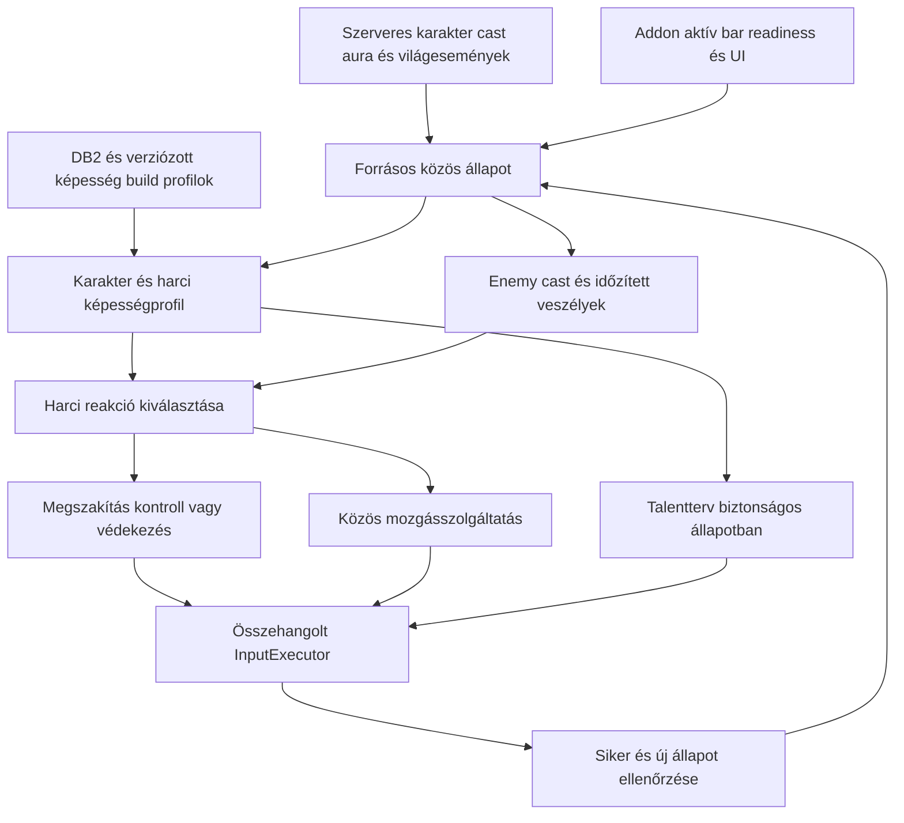

# Harc, karakterprofil és automatikus talentkiosztás


## Forrásellenőrzött REV4 korrekció – olvasd el a régi fejezetek előtt

**Állapot:** a `src (2).zip` 498 Python-fájljának AST + statikus importgráf elemzése és a kritikus futási láncok forráshelyi ellenőrzése megtörtént. **Ez nem teljes függvényenkénti live audit**, és a ZIP nem tartalmazza a `tests/` fájlokat, a Lua addon producert vagy a natív Ymir producercsatornát. Az új célmodulok nem implementációk. A teljes új, pontos fájl→API→tulajdonos migrációs indoklás a `SRC_MELY_AUDIT_20261029_HU.md` dokumentumban van; a `SRC_498_MODUL_LELTAR_20261029.csv` csak statikus leltár.

**A legfontosabb új, kóddal alátámasztott döntések:**

1. A `navigation/flight_trip.py` és `flight_travel.py` **már be van kötve** a `navigation/global_planner.py:208–209` hívásba, ezért a travel redesign a működő mixed-flight út kiterjesztése, nem a nulláról új bekötés. A `flight_trip.TripPlan` még nem a végleges általános `TripLeg`-sorozat.
2. A `navigation/danger.py:100–175` és `spawn_threats.py` **már tartalmaz veszélyes mobkerülést**. A `RouteRiskEvaluator` az előrejelzett harcidő/HP-veszteség/aggro + flight/transition cost **új rétege**, ne második DangerMap legyen.
3. Az `agent/quest_graph.py:8–122` **már ismeri** az objective/quest dependency readiness-t; az új `QuestExecutionGraph` **belső mechanikalépéseket** ír le, nem lecseréli a questláncot. `quests/objective_mechanics.py` már aktív TDB/DB2 classifier, `agent/tdb_knowledge.py` fogyasztja.
4. `agent/engine.py:79–88` dinamikusan csatol nav oracle-okat WorldModelhez, és `tdb_locations.route_cost_oracle` **modulszintű globális metódushivatkozás**. Ezt explicit, példányonkénti porttá kell tenni a multi-PID izoláció érdekében.
5. `packetio/context.py:16–38` és `agent/runtime_packet_source.py:68–93` a mai packet bootstraphez addon-state-et követel; `agent/world.py:360–428` session ownershipja is az addon megfigyeléssel kapcsolódik össze. **Az addonmezőket addig nem lehet törölni**, amíg új bootstrap + field parity + input/UI regression nincs.
6. A fő `agent/runtime.py:356–362` **jelenleg is hívja a vizuális update-et**, a `skills/combat.py` és `agent/target_manager.py` is tartalmaz visual-track alapú logikát. A no-vision runtime csak consumer-szintű kivezetéssel készül el.
7. Az importgráf szerint `agent.models`-ra 196 modultól jön hivatkozás; egy 32-modulos import-SCC mutat erős összekapcsoltságot. **Előbb szerződések és átmeneti facade-ok, később a fájlmozgatás.**
8. `execution/command_dispatch.py` és `agent/executor.py` megtartja az **egyetlen input authorityt**, az ACK ≠ világállapot-siker elvet, a PID, foreground, bindings, watchdog védelmeket. Az új Travel/Combat/Quest modulok nem kerülhetik meg.

**Külön ellenőrzött source-különbségek:** `world_packet_reducer.py:677–740` még addonstate-ből egészíti ki a saját packetes pozíció-/instance- és mapkörnyezetet; a teljes packetes quest-POI-tárolóból a fogyasztóknak csak a turn-in blobokat teszi ki. A `danger.py:50–65` veszélyprovenance címe fix `ADDON_TELEMETRY`, ezért ezt mezőszinten javítani kell a risk-kalkuláció előtt. Ezekből önmagukban nem következik live hiba, de migráció előtti tesztesetek.

**Ajánlott függőségi ütemezés:** `P0 baseline/trace → P1 contracts + DI + oracle isolation → P2 session bootstrap → P3 addon/packet mező parity → P4 no-vision runtime → P5 leg-based Travel/Transition → P6 RouteRisk → P7 Combat + roles → P8 mechanic-based Quest → P9 legacy cleanup/LLM calibration`. A régebbi T0–T8 ütemeket nem szabad automatikusan késznek vagy ennek megfelelőnek tekinteni.

---

**Tervezési kiegészítés — 2026. október 29., Europe/Budapest.**

Ez a felhasználó három új combatkövetelményét rögzíti: enemy cast figyelése és megszakítás/kitérés; a saját classhoz és felépítéshez illő játék; szabad talentpontok automatikus kiosztása. A cél továbbra is **ellenőrzött szerveradat + strukturált addontelemetria**, képfelismerés nélkül. A kiegészítés tervezett működés, nem elkészült vagy live-validált funkció. A munkában nincs agentkód-módosítás, talentköltés vagy kliensvezérlés.

## 1. A három követelmény közös alapja

Az agent ugyanabból a friss állapotból ismerje a saját karakter képességeit, a harci ellenfelek castjait és az aktív veszélyeket. Ezek alapján válasszon támadást, megszakítást, kontrollt, védekezést vagy helyezkedést. A questcél, a harci célpont és a mozgási szándék kapcsolata a reakciók közben maradjon követhető.



Ez felelősségi bontás: nem követelmény új, különálló combatagy vagy második inputvégrehajtó létrehozása. A reagáló döntések a meglévő közös vezérlési lánc részei legyenek. A meglévő class-/ability-adatot és jó végrehajtórészeket a megfelelő helyen újra lehet használni.

## 2. Mit tud ma a vizsgált kód, és mi hiányzik?

| Megfigyelés | Korlát és tervezett következmény |
|---|---|
| Az addon már lekéri a saját `UnitClass` tokenjét, és `class` mezőt exportál. [Saját class mai addonadata](<C:/Users/<user>/Documents/ChatGPT/ai_visual_bot_midnight claude/ai_visual_bot_midnight 1.2/projekt/addon/AIPlayerControllerExport/AIPlayerControllerExport.lua:2460>) | A class alapadata már létezik. Ez nem teljes spec-/talent-/forma-/pet- és szerepprofil. |
| A közös `AbilityRuleEngine` kezeli az actionbart, a használhatóságot, a cooldown/ismeretlen cooldown elutasítását, az erőforrást és az előfeltételeket. [Mai ability rule engine](<C:/Users/<user>/Documents/ChatGPT/ai_visual_bot_midnight claude/ai_visual_bot_midnight 1.2/projekt/src/wowbot/skills/ability_rules.py:83>) | Értékes alap. Az `INTERRUPT` tag vagy egy prioritásszám önmagában nem castfüggő megszakítási döntés. |
| A `combat_ability_catalog` beépített alapértékei három Warrior-képességet írnak le. [Mai kis képesség-katalógus](<C:/Users/<user>/Documents/ChatGPT/ai_visual_bot_midnight claude/ai_visual_bot_midnight 1.2/projekt/src/wowbot/skills/combat_ability_catalog.py:12>) | Ez nem minden class és spec teljes harci támogatása. Profil- és lefedettségi rendszer kell. |
| A mai packetallowlistben nincs teljes enemy cast-start/update/stop, interrupt-result vagy területi veszély-életciklus. [Packetes allowlist](<C:/Users/<user>/Documents/ChatGPT/ai_visual_bot_midnight claude/ai_visual_bot_midnight 1.2/projekt/src/wowbot/packetio/validation.py:7>) | Az új reakciókhoz ellenőrzött adatút és fogyasztó is kell; pusztán új spellprioritás nem elég. |
| Az addon vizsgált UNIT_SPELLCAST eseményága a player/vehicle/pet egységet exportálja. [Addon cast-események mai köre](<C:/Users/<user>/Documents/ChatGPT/ai_visual_bot_midnight claude/ai_visual_bot_midnight 1.2/projekt/addon/AIPlayerControllerExport/AIPlayerControllerExport.lua:3402>) | Nem teljes, az összes releváns ellenfelet figyelő castforrás. A publikus target cast adat is csak ellenőrzött kiegészítés lehet. |
| A mai `DangerMap` bejegyzései alapvetően XY-középpontot és sugarat tartalmaznak, lejáró költséggel. [Mai helyi veszélybejegyzés](<C:/Users/<user>/Documents/ChatGPT/ai_visual_bot_midnight claude/ai_visual_bot_midnight 1.2/projekt/src/wowbot/navigation/danger.py:9>) | Nem azonos egy időzített, több alakzatot és floor/Z-t kezelő harci AoE-modellel. |

A meglévő kód működő részei megmaradhatnak. A táblázat nem állítja, hogy minden combatképesség hiányzik; az új felhasználói elvárások teljesítését kell külön igazolni. A korábbi offline/live eredményeket az új funkciók nem öröklik automatikusan.

## 3. A saját karakter azonosítása és profilja

Az agent a kifejezetten kiválasztott karakter **megfigyelt class ID/token, specializáció, szint, aktív talentkonfiguráció, ismert spellkészlet, erőforrások, felszerelési feltételek, aktuális forma/stance és petállapot** alapján dolgozzon. A class nevét nem a karakter nevéből vagy az első actionbargombból találja ki.

A szervertől a normál kliensfolyamban megkapott, ellenőrzött saját character/player/spell/talent adat az elsődleges a megfelelő mezőkben. Amíg valamely adat nincs megbízhatóan dekódolva vagy a kliens helyi állapotát jelenti, a publikus addonadat külön forrással adhatja. A kérés nem új, tetszőleges játékpacketek küldését jelenti. A hiányzó spec vagy jogosultság `UNKNOWN`, és nem vált ki feltételezett Warrior-profilt.

| Profilrész | Szükséges tartalom |
|---|---|
| Identitás és konfiguráció | Saját karakter, class ID/token, spec ID, szerep, aktív loadout/config és profilrevizió |
| Harci képességek | Ismert és az adott kontextusban aktiválható spellek; megfelelő aktív bar és igazolt binding |
| Erőforrások | Az adott class/spec számára releváns típusok, aktuális érték, költség és termelés; több erőforrás is lehet |
| Forma/stance/állapot | Például stealth, druidforma, stance, pet/vehicle állapot, silence/root/stun és saját folyamatban levő cast |
| Taktika | Melee/ranged/mixed jelleg, kívánt távolságtartomány, petkezelés, opener, single-target/AoE, védekezés és menekülés |
| Build | Szerephez és tartalomhoz kiválasztott talentterv, már kiosztott pontok és kompatibilitás |

Szintlépés, spec-/talentváltás, tanult spell, forma-/petváltozás vagy actionbarrevizió frissítse az érintett képességeket és terveket. Másik karakterre átváltva ne maradjon régi rotáció, targetcommit, erőforrásbecslés vagy talentköltési kérés.

## 4. Classhoz és spechez illő harcmodor

A class csak az első felosztás. A tényleges harcmodort a spec, a forma, a talentek és az elérhető képességek határozzák meg. Nem megfelelő az a szabály, hogy minden hunter mindig távolsági, vagy minden druid mindig caster. A Blizzard classleírása is megkülönbözteti a hunter közel- és távolsági játékát, a rogue pedig stealthből indító, erőforrásokra és kombókra építő példát ad. [Hunter](https://worldofwarcraft.blizzard.com/en-gb/game/classes/hunter), [Rogue](https://worldofwarcraft.blizzard.com/en-us/game/classes/rogue).

Az alábbi táblázat profilkövetelményeket szemléltet. Nem kész rotáció, nem minden buildre azonos képességlista és nem fix hatótávolság-adatbázis.

| Class | A profil által kezelendő jellegzetesség |
|---|---|
| Warrior | Melee-távolság, rage, tank/DPS szerep és felszerelés; megszakítás, kontroll és mobility külön feltételekkel |
| Death Knight | Melee, rúnák/runic power, szerepfüggő védekezés; aktuális pet és ismert kontrollok |
| Rogue | Melee, energy/combo erőforrás, stealth és abból használható opener; célhoz kötött előfeltételek |
| Mage | Ranged caster, az adott spec erőforrása és cast-/channel-ablaka; mozgás alatt használható képesség, védekezés és kontroll |
| Warlock | Ranged caster, tényleges erőforrások és DoT/pet mechanika; az aktív pethez kötött képességek és megszakítás |
| Hunter | Spec szerinti ranged vagy melee, focus, tényleges petállapot; csapda, kite és mobility a konkrét build szerint |
| Paladin | Tank/melee DPS/healer szerep, erőforrás és aktuális támadó/gyógyító képességek; nincs egységes classszintű távolság |
| Priest | Spec szerinti caster/healer mechanika, erőforrás, pajzs/gyógyítás és ténylegesen ismert kontroll |
| Shaman | Spec szerinti melee/ranged/healer működés, erőforrások, totemek és elérhető megszakítás |
| Druid | Aktuális forma és spec szerinti melee/ranged/tank/healer működés; formaváltáskor képesség- és barkontextus-váltás |
| Monk | Szerep/spec szerinti melee és gyógyító működés, releváns erőforrások, mobility és védekezés |
| Demon Hunter | Az aktuális spec melee/ranged jellegének tényleges ismerete, erőforrás, mobility és szerepfüggő védekezés |
| Evoker | Spec szerinti caster/healer/support működés, tényleges range, empower/channel és mozgási feltételek |

A profilok az aktuális buildhez és spellkészlethez verziózott adatok legyenek. A DB2 adhat statikus spellalakzatot, range-et, költséget vagy kapcsolódó azonosítót; az aktív ismeret, talent, pillanatnyi használhatóság és binding külön állapot. Nem szabad minden létező classspell használhatóságát feltételezni.

A „minden class megfelelően” külön lefedettségi nyilvántartást jelent class/spec és fontos szint-/buildtartomány szerint: hiányzó profil, alapműködés, offline tesztelt rotáció/reakció, majd user-live igazolás. Egy generikus abilitylistából kiválasztott működő támadás nem teljes class-spec támogatás. Teljes dungeon-/raid-healer vagy tank szerep külön csoportadatot és elfogadási próbát igényel; a class felismerése nem teszi ezt automatikusan kész funkcióvá.

## 5. Helyezkedés meleevel és casterrel

A kívánt távolság a következő használni kívánt képesség min/max range-je, a cél combat reach-e, a saját szerep, a cél és a terep alapján adódjon. Legyen tartomány és hiszterézis; a karakter ne lépkedjen folyamatosan előre-hátra ugyanazon határ körül.

- **Melee:** elérhető közelharci távolság, megfelelő facing, a veszélyes frontal elkerülése; szükség esetén célkövetés. Hátra kerülés csak ha a mechanika/ability indokolja és az út járható.
- **Caster/ranged:** lehetőség szerint működő támadótávolság és szabad támadási irány megtartása; ne fusson automatikusan a mob lábához. Ne távolodjon túl az elérhető spellek hatótávján, és ne szakítsa meg folyamatos mozgással a saját sebző castját.
- **Petes karakter:** a saját pozíció és a pet támadási/interrupt elérhetősége külön. A pet halála, eltűnése vagy rossz helyzete az érintett képességet ténylegesen elérhetetlenné teheti.
- **Veszély:** az ideális DPS-távolság átmenetileg feladható a túlélésért. A kimozgás után friss helyzetből számolt visszatérés kell, nem a régi útvonal vak folytatása.

A kiting célirányos és korlátos legyen. A csupán „caster vagyok” állapot nem indokol végtelen menekülést, új mobok behúzását vagy a target resetjét.

## 6. Rogue stealth és speciális állapotok

A rogue profil a megfelelő, ténylegesen elérhető Stealth-képességet harcon kívüli megközelítéshez és a támogatott openerhez használja. A helyi aktív bar, binding, readiness és a karakter feltételei ellenőrzöttek legyenek. A gombnyomást követően az aura/forma tényleges megváltozása igazolja a stealth állapotot; addig a stealth-only opener nem engedélyezett.

A megközelítés ne indítson idő előtt autoattackot vagy a stealtht feloldó másik akciót. A stealthből kezdeményezés az aktuális harci/questcélhoz kötött, nem minden közelben levő egységre végzett automatikus támadás. Stealth nem jelent garantált észrevehetetlenséget vagy szabad utat veszélyes zónában. Az elbukott stealth, harcba kerülés, megfelelő cooldown hiánya és ismert reveal hatás külön állapot.

A formák, stancék, petparancsok és ideiglenes spelloverride-ok ugyanilyen tényleges állapotváltási szerződést kapjanak. Ismeretlen állapotból nem lehet következő akcióra jogosultságot levezetni.

## 7. Enemy cast/channel figyelése

A saját target mellett a releváns közeli ellenfelek és támadók castjait is ismerni kell, amennyiben az ellenőrzött adatforrás látja őket. A pillanatnyi selected target és a veszélyt okozó caster külön referenciák lehetnek.

Egy cast rekordja: caster GUID, konkrét castpéldány-azonosító, spell ID, start/update/end idő, channel/tick jelleg, ismert cél-GUID vagy világkoordináta, szakíthatóság, ismert kontrollfeltételek, forrás és frissesség. A megszakítható, nem megszakítható és ismeretlen állapot külön érték. A caster `target_guid` mezője önmagában nem azonos az adott spell tényleges céljával.

A tervezett adatút az exact-build módon igazolt cast-start/update/stop/channel, cast-/interrupt eredmény és szükséges aura/immune eseményekre épül. A publikus addon castinformáció kiegészíthet, ha hozzáférhető; nem hozzáférhető vagy titkos érték `UNKNOWN`. A jelenlegi adatút hiányait új, szűk eseménysémákon és reduceren keresztül kell pótolni.

A cast vége, megszakítása, eltolása, újrakezdése, targetcsere, caster eltűnése, új session és időtúllépés érvénytelenítse a régi megszakítási kísérletet. Nem elég egy általános `target_is_casting` boolt tárolni.

## 8. Megszakítás és kontroll: Pummel, Storm Bolt és más classok

A saját aktuális képességeinket funkció szerint kell szétválasztani: közvetlen interrupt, stun vagy más kontroll, mozgási képesség, illetve védekezés. Warrior példában a Pummel közvetlen megszakítási jelölt; a Storm Bolt kontroll/stun jelölt, amelynek használhatósága külön cél- és hatásfeltételektől függ. A tényleges buildben ismert és működő spellváltozat adata a mérvadó. A közvetlen megszakítás és a CC nem automatikusan felcserélhető; egy nem interruptálható cast ettől még lehet kontrollal megállítható, más cél viszont immunis lehet a stunra.

Minden kísérlet feltétele: pontos caster/cast azonosság; még fennálló és időben elérhető reakció; a megfelelő interrupt/CC típus engedélyezettsége; ismert/használható saját képesség, cooldown/charge/erőforrás; friss aktív bar és igazolt binding; range, facing és a rendelkezésre álló LoS/terepkorlátok. Petes megszakításnál a pet elérhetősége és saját pozíciója is számít. Nem szabad egy nem létező Pummelt vagy tetszőleges pótló billentyűt feltételezni.

A cast veszélyessége és a cél dönti el, érdemes-e megszakítani: nagy sebzés, káros kontroll, fontos heal/buff vagy más igazolt mechanika eltérő prioritást kaphat. Az elérhető reakcióidő számításába a telemetria kora, bizonytalanság, inputkésleltetés, szükséges fordulás/célváltás és képesség-aktiválás ideje is kerüljön. Az utolsó pillanat kivárása csak igazolt mechanikai okkal és elegendő tartalékkal vállalható.

Ha saját cast/channel közben kell reagálni, a profil döntse el, megszakítható-e/megéri-e feladni azt. Castcancel csak a normál, igazolt kliensaktiválási úton történhet. Az enemy cast megszakítása és a saját cast feladása külön esemény és eredmény legyen.

Sikert az adott enemy castpéldányhoz kapcsolt interrupt/CC hatás és megfelelő állapotváltozás igazoljon. A saját spell sikeres elsütése, cooldownja vagy az enemy cast természetes befejezése önmagában nem bizonyít sikeres megszakítást. Ha közben más megszakította vagy a caster meghalt, ne fogyjon újabb interrupt. Egy sikertelen/immune eredmény frissítse a megfelelő, kontextusos hibát; nem jogosít végtelen spamre.

## 9. AoE, frontal és egyéb elkerülhető támadások

A harci veszély legyen külön tér-időbeli adat: forrás/caster/castpéldány, spell vagy area-trigger ID, map/instance/floor, középpont/pálya/irány, alakzat és méret, telegraph/aktiválódás/lejárat, mozgás és bizonyítékminőség. Kör/gyűrű, kúp, vonal, söprés/charge, állandó vagy mozgó zóna eltérő geometriát igényel. A saját testméret, sebesség és a telemetria bizonytalansága biztonsági tartalékot ad.

Nem elég csak azokat a spelleket figyelni, amelyek minket targetelnek. Másra célzott frontal, ground AoE vagy területen végigmenő támadás is érinthet minket. A döntéshez a saját várható pálya és a veszély tartományának metszése számít. Ugyanakkor minden enemy cast miatt automatikusan menekülni sem helyes: egy távoli, minket nem veszélyeztető zóna nem igényel kimozgást.

A geometria ellenőrzött szerveres cél-/area-trigger adatból, aktuális casterpozícióból és ismert, helyi DB2/spell/mechanikaprofilból épülhet. A statikus radius nem bizonyítja az aktuális zóna helyét vagy aktiválódását. A felületlejáratot és a valódi hatás létrejöttét is követni kell; egy már létrejött ground effect a caster castjának végétől nem feltétlenül szűnik meg.

A kitérő a közös mozgásszolgáltatás rövid, időkorlátos kérése legyen. A rendszer értékeljen több közeli járható pontot: még az impact előtt kiérünk-e; az útvonal is biztonságos-e; ugyanazon megfelelő flooron maradunk-e; nem esünk-e le; nem lépünk-e más AoE-ba vagy fölösleges új ellenfelekhez. A célpont veszélyforrásként való figyelmen kívül hagyása a szokásos combatmegközelítésnél nem jelentheti a tőle származó sebző AoE kihagyását.

Meleevel tipikusan rövid oldalirányú/megfelelő helyezkedés, casterrel a castveszteséget és range-et is figyelembe vevő biztonságos pont jöhet szóba. Mobility képesség csak a konkrét classprofilból, ellenőrzött aktiválással és megfelelő érkezési hellyel használható. Root/stun, rövid hátralevő idő vagy hiányzó járható út esetén alternatív interrupt/CC/defensive jöhet szóba. Nem minden célzott sebzés kerülhető ki mozgással.

**Korlát vizuális érzékelés nélkül:** nem garantálható minden képi telegraph felismerése. Ha egy effekt helye/irányítása csak a kliens megjelenítésében áll rendelkezésre, és sem a packet, sem a publikus addon, sem az ellenőrzött kliensadat nem ad elég információt, a pontos kitérés képessége `UNKNOWN/UNSUPPORTED` marad. Ez nem indok a vizuális ág visszaépítésére vagy zónakoordináták kitalálására.

## 10. Reakciók sorrendje és visszatérés

A túlélési reakció, a veszélyes cast megállítása és a normál sebzés közös döntést igényel. A rendszer a konkrét időablakból válasszon: egy még időben végrehajtható interrupt megszüntetheti a veszélyt, de egy közvetlenül alattunk aktiválódó másik AoE-ból eközben is ki kell érni. A sorrend nem merev „mindig előbb kick, utána mozgás” szabály.

Ne fusson egymással versengő melee-chase, casthelyreállítás és AoE-kitérés. A közös inputkoordináció őrizze az akciók és mozgásparancsok tulajdonát; az alkalmas képesség és mozgás összehangolható, ha a játék és a profil megengedi. A veszély megszűnése után friss target, range, saját állapot és questkontextus alapján folytatódjon a harc. A régi castpéldányra ne érkezzen késői kísérlet.

A helyi LLM előzetesen segíthet spellleírásból mechanikajelöltet vagy taktikai profilt készíteni. A másodperces castreakciót és kitérési irányt a gyors, determinisztikus vezérlő dönti el friss állapotból; ehhez nem vár LLM-válaszra.

## 11. Automatikus talentpont-kiosztás

A saját karakterprofilhoz tartozzon **verziózott, class-/spec-/szint-/tartalomfüggő talentbuild**, aktív konfiguráció és a jelenleg elérhető szabad pontok. A felhasználó kérése alapján a buildhez illő szabad pontok automatikus felhasználása tervezett képesség. A már kiválasztott talentek alaphelyzetben megmaradnak; a meglévő build teljes resetje vagy másik spec/loadout választása külön konfigurációs döntés.

A profilhoz választható például solo/leveling, tank, healer vagy más tartalomhoz tartozó build. A jelenlegi questelési célhoz indokolt solo/leveling jelölt készíthető, de a meglévő karakter tényleges specjét és felhasználói választásait tiszteletben kell tartani. Teljes buildet és pontsorrendet a profil tároljon; a modell ne rögtönözzön minden szintlépésnél új irányt.

Az aktuális buildben támogatott class-, spec- és hero-talent ponttípusok, node/entry/rank azonosítók, függőségek, költségek és feloldási feltételek külön adatnak számítanak. A rendszer a tényleges tree/config állapotot olvassa; nem feltételez minden szinthez ugyanannyi vagy ugyanolyan pontot. A Blizzard anyagai is elkülönítik a class/spec/hero fákat; a konkrét szintek és nodeazonosítók az aktuális kliensből igazolandók. [Midnight talentirányok](https://worldofwarcraft.blizzard.com/en-us/news/24223575/watch-the-gamescom-2025-systems-download-panel-vod).

Tervezett folyamat:

1. **Kiváltó esemény:** szintlépés, pont-/talentkonfiguráció-változás, belépés/reconnect vagy elhalasztott kiosztás utáni biztonságos állapot. Már korábban megmaradt pontot is felismer.
2. **Friss állapot:** saját karakter, class/spec, aktív config/tree, ponttípusok és szabad egyenleg; a publikus addon UI és a szerver visszaigazolt adatai forrással elkülönítve.
3. **Biztonságos pillanat:** nincs aktív harc, veszély, loading vagy blokkoló inputállapot. Ha szintlépés harc közben történik, a pont megmarad és a kiosztás vár.
4. **Build következő lépése:** a kívánt, még ki nem osztott és jelenleg legális node/choice/rank kiválasztása. Előfeltétel, max rank, költség és pontos ponttípus ellenőrzése; nem létező régi node ID nem fogadható el.
5. **Érvényes kiosztási terv:** a kliens aktuális alkalmazási szabályai szerint megfelelő pontcsoport. Ha az UI az alkalmazáshoz az összes elérhető pont kiosztását követeli meg, a teljes szükséges tervet kell előkészíteni; ezt nem szabad régi patchszabályból vagy feltételezett egyenkénti commitból kitalálni.
6. **Normál UI-aktiválás:** a meglévő, igazolt bindinggal megnyitott talentablak; az addonból kapott aktuális, látható node/choice/apply állapot és UI-koordináták. Nincs képfelismerés, tetszőleges packetküldés, injektált Lua, védett API-kényszerítés vagy koordinátatalálgatás. Hiányzó UI-aktiválási támogatás külön képességhiány.
7. **Alkalmazás ellenőrzése:** a tényleges configrevizió, node/entry/rank és felhasznált pontváltozás megerősíti az eredményt. Egy kattintás vagy csak a kliens még nem alkalmazott preview-ja nem siker.
8. **Harci profil frissítése:** új képesség/talentmódosítás után ismert spellkészlet, költségek, cooldownkapcsolatok, forma/bar és taktikai szabályok újraértékelése. Hiányzó új binding explicit hiány marad; nem keletkezik találgatott gyorsbillentyű.

Több pont, részleges alkalmazás, visszautasítás, UI bezárás, disconnect vagy a felhasználó közben végzett manuális talentmódosítása friss állapotból új tervet kér. Ugyanaz a régi kérés nem költhet kétszer. Más karakter/spec, config vagy buildverzió megjelenése érvényteleníti a függő műveletet. Nem kompatibilis buildnél a rendszer pontos hiányt jelent és megtartja a pontokat; nem választ véletlen talentet.

Az LLM a build céljának értelmezésében és ellenőrzött jelöltek összehasonlításában segíthet. A nodegráf, költség, jogosultság és kiosztási eredmény ellenőrzése determinisztikus. A talentkiosztás ezután classhoz illő harci képességfrissítést eredményez, nem pusztán egy elköltött pont számlálóját.

## 12. Adatúti és megvalósítási ütemek

Minden alábbi ütem státusza: **tervezett, ebben a munkában nem implementált és nem live-validált**. A sorrend a fő terv T0–T8 ütemeihez kapcsolható, a régi V4-et nem teszi újra irányadóvá.

| Ütem | Konkrét eredmény |
|---|---|
| C0 — forrásképességek | Mely own-character, spec/talent, cast, aura és hazard mező érhető el ellenőrzött packetből vagy publikus addonból; hiány és frissesség explicit |
| C1 — karakterprofil | Saját class/spec/level/form/pet/erőforrás és ténylegesen elérhető képességek, stabil kontextusváltással |
| C2 — alap harcmodor | Melee/ranged/mixed távolság és szerep, class/spec profilok, stealth/pet/form előfeltételek; első körben kiválasztott profilok teljes igazolása |
| C3 — castreakció | Konkrét enemy castpéldány, interrupt/CC alkalmasság, késleltetés- és eredményellenőrzés; több caster kezelése |
| C4 — időzített veszélyek | Ismert alakzatok és futó geometriák, közös kitérő mozgás, több veszély és floor; nem támogatott mechanikák listája |
| C5 — talentprogresszió | Build/tree/points provider, normál addon/UI aktiválás, commitigazolás és az ebből következő profilfrissítés |
| C6 — class/spec lefedettség | Profilonként külön offline és user-live eredmény; a teljes támogatás csak konkrét bizonyítékkal állítható |

## 13. Elfogadási próbák

| Próba | Elvárt eredmény |
|---|---|
| Másik karakter/class vagy spec betöltése | Nincs megmaradt Warrior-rotáció, rossz resource vagy régi target/config |
| Ranged caster és melee ugyanazon questmob ellen | Képességfüggő, eltérő megközelítés és működő támadótávolság |
| Melee/ranged specváltás ugyanazon classon belül | A profil és range megváltozik; nem a class neve rögzíti örökre a módot |
| Forma, bar vagy pet változik | Csak az aktuálisan rendelkezésre álló képességek választhatók |
| Rogue stealth siker/hiány/kudarc | Csak megerősített stealth után megfelelő opener; nincs idő előtti autoattack |
| Szakítható veszélyes enemy cast és használható interrupt | A megfelelő castpéldányra időben kísérlet, tényleges eredményellenőrzéssel |
| Nem interruptálható cast, de külön igazoltan kontrollálható cél | Csak alkalmas CC-reakció; a két mechanizmus nem keveredik |
| Stunimmunis cél, cooldownos/hiányzó spell vagy binding | Nincs kontrollspam vagy kitalált billentyű; megfelelő alternatíva/hiányjelzés |
| Cast természetesen véget ér vagy más megállítja | Nincs elavult interrupt és nincs téves saját sikerkönyvelés |
| Másra célzott frontal/ground AoE érint minket | A térbeli/időbeli érintettség alapján kimozgás, a caster targetjétől függetlenül |
| Az enemy cast nem veszélyeztet minket és nem igényel más reakciót | Nincs indokolatlan menekülés |
| A veszélyes caster a saját DPS-targetünk | A hozzá tartozó AoE-t a target-exemption nem tünteti el |
| Több AoE, híd/másik floor vagy részleges MMAP | Olyan út/pont, amely az ismert veszélyeket és a járhatóságot is teljesíti; nincs rossz floor vagy szakadék |
| Root/stun vagy túl késői észlelés | Elérhető alternatíva vagy pontos képtelenségi ok; nincs garantáltnak mondott kitérés |
| Veszély csak megjelenítésből lenne felismerhető | `UNKNOWN/UNSUPPORTED`; nem indul képfelismerés és nincs kitalált hazard |
| Megszakítás/kitérés után folytatás | Friss target/range/questállapotból rendezett harc; nem versengő chase és menekülés |
| Szintlépés pont nélkül | Nincs üres talentkattintgatás |
| Szintlépés szabad class/spec/hero ponttal | A megfelelő ponttípusból, a kompatibilis build szerint kiosztási terv |
| Szabad pont maradt korábbi sessionből | Belépés után is felismeri és megfelelő alkalommal felhasználja |
| Szintlépés harc/veszély/loading alatt | A kiosztás vár; harc és inputbiztonság az első |
| Több pont és a kliens teljes kiosztást kér az alkalmazáshoz | Legális teljes terv és ellenőrzött commit, nem feltételezett egyenkénti siker |
| Talent előfeltétel/rank/choice/currency nem megfelelő | Nincs érvénytelen költés; pontos hiány/kompatibilitási státusz |
| Felhasználó közben manuálisan talentet választ | Friss konfigurációból új terv; a döntést nem írja felül régi kérés |
| Apply visszautasítás vagy disconnect | A preview nem könyvelődik el; nincs duplikált költés, reconnect után resnapshot |
| Új talent új képességet vagy módosítást ad | Harci profil frissül; igazolatlan binding nem válik aktívvá |
| Az LLM nem válaszol | A cast-/veszélyreakció és ismert harcmodor tovább működik |

Az offline replay a szerződéseket és döntéseket vizsgálja. A sikeres valódi interrupt, kitérés, classhoz illő harc és talentalkalmazás csak felhasználó által végzett live teszttel igazolható. Az asszisztens a naplót és a megfigyelt eredményt elemzi; ebben a tervezési munkában nem veszi át a kliens inputját.

Kapcsolódó fődokumentum: [szerveres + addon architektúraterv](<C:/Users/<user>/Documents/ChatGPT/ai_visual_bot_midnight 1.2/output/server_first_proposal_20261029/ARCHITEKTURA_TERV_20261029_HU.md>).

---

# 2026-10-29 — Combat architektúra részletes bontása

> **Státusz:** tervezett célfelépítés. A jelen fejezet a meglévő combat követelményeket finomabb runtime-felelősségekre bontja; nem állítja, hogy ezek az osztályok vagy viselkedések már implementáltak/live-validáltak.

## 14. A CombatSystem ne legyen monolit

A végleges combat ne egyetlen `CombatController` legyen, amely célzást, facinget, rotációt, interruptot, defensivet, mozgást és multi-target döntést egyszerre kezel. Javasolt felelősségi bontás:

```text
CombatContext
├── TargetSystem
├── FacingController
├── MultiTargetSystem / CombatEntitySet
├── CharacterProfile
├── AbilitySystem
├── ResourceSystem
├── CooldownSystem
├── DamageModel
├── RotationSystem
├── DefensiveSystem
├── CastTracker
├── SpellDangerClassifier
├── InterruptPlanner
├── CCFallbackPlanner
├── PositioningSystem
├── ThreatSystem
├── HazardReactionSystem
├── CombatStateMachine
├── CombatArbitrator
├── CombatVerifier
└── CombatRecorder / PolicyOptimizer
```

## 15. TargetSystem és FacingController

A TargetSystem feladata:

```text
candidate discovery
candidate scoring
acquire target
target identity verification
target commitment / lock
target switching
range/reachability
validity / death / despawn
lost-target recovery
```

A Facing külön controller legyen. Packetből ismert saját pozíció/facing és a mob világpozíciója alapján számolható a kívánt heading és angle error. A FacingController outputja például `FACE_OK`, `TURN_LEFT`, `TURN_RIGHT` lehet; a konkrét rövid inputot a közös mozgásvezérlés adja.

A Facing nem kizárólag az aktuális DPS-target felé mutatás: cone ability, interrupt target, hazard escape vagy role-specific positioning más kívánt irányt is adhat.

## 16. MultiTargetSystem és CombatEntitySet

A multi-target döntés ne `enemy_count >= 3 → AoE` legyen. A CombatEntitySet minden releváns ellenségnél tartson legalább:

```text
guid / entry
position / distance
health / alive
attacking_us / attacking_party
current cast / danger
quest relevance
elite/boss/special flags
CC state
engaged vs nearby-non-engaged
```

Származtatott csoportok:

```text
active_enemies
engaged_enemies
nearby_non_engaged
melee_cluster
aoe_cluster
priority_targets
dangerous_casters
```

Az AoE/cleave döntés vegye figyelembe, hogy az effekt behúz-e jelenleg nem engaged mobot.

## 17. AbilitySystem: definíció és pillanatnyi állapot külön

```text
AbilityDefinition
├── spell_id / variants
├── min/max range
├── GCD / cast / channel
├── cost / generation
├── base cooldown / charges
├── target type
├── facing / moving conditions
└── functional tags

AbilityState
├── known / talented
├── bound / active bar
├── ready / cooldown remaining
├── current charges
├── resource affordable
├── in_range
├── usable_now
└── context validity
```

Funkcionális tagek például:

```text
DAMAGE, AOE, DOT, EXECUTE, BUFF,
INTERRUPT, STUN, CC,
DEFENSIVE, HEAL, MOBILITY
```

A DB2 statikus spellmeta nem bizonyítja, hogy a karakter tudja, talentelte, bindolta vagy pillanatnyilag használhatja a spellt.

## 18. ResourceSystem és CooldownSystem

A ResourceSystem legyen classfüggetlen absztrakció több erőforrásra:

```text
RAGE, ENERGY, MANA, FOCUS,
RUNIC_POWER, RUNES, COMBO_POINTS,
SOUL_SHARDS, HOLY_POWER, ESSENCE, ...
```

Tartsa: current/max, regen, cost, generation, overcap risk és – ahol megbízható – következő action utáni becslést.

A CooldownSystem külön kategóriákat kezeljen:

```text
minor offensive
major offensive
minor defensive
major defensive
mobility
interrupt
CC
trinket/racial
```

Ne használjon automatikusan nagy cooldownot rövid életű quest mobra; becsült TTD, boss/elite/pull size és várható következő harc is számíthat.

## 19. DamageModel és RotationSystem

A `RotationSystem` ne fix `1→2→3→4` lista legyen. A realtime döntés priority/utility alapú legyen:

```text
CombatState
→ eligible AbilityCandidates
→ score / priority / deadline
→ best normal combat action
```

A DamageModel szolgáltathat:

```text
expected_damage
expected_dps
expected_resource_gain
expected_buff/proc value
expected_dot value
expected_aoe value
```

Az első verzió lehet kézzel/profile-ból definiált priority, később combatlogból tanult értékekkel finomítható.

### 19.1 LLM szerepe

Az LLM **ne minden GCD-n döntsön**. Használható offline/profile-szinten:

```text
spell metadata + talents + combat logs + current policy
→ policy candidate / rule suggestion
→ offline replay / benchmark
→ elfogadott verziózott RotationPolicy
```

Realtime cast/interrupt/rotation döntés gyors, determinisztikus és friss state-ből történjen.

## 20. DefensiveSystem és IncomingDamageEstimator

A DefensiveSystem ne puszta HP-threshold legyen. Input lehet:

```text
current HP
recent/incoming damage
enemy count
dangerous casts / hazards
debuffs / CC
available defensives / heal / potion
role + healer availability
```

Output:

```text
NO_ACTION
MINOR_DEFENSIVE
MAJOR_DEFENSIVE
SELF_HEAL
KITE / ESCAPE
POTION / HEALTHSTONE
```

A magas incoming damage indokolhat preventív defensivet akkor is, ha a HP még nem kritikus.

## 21. Cast/interrupt lánc

A jelen enemy-cast követelmény további belső bontása:

```text
CastTracker
    ↓
SpellDangerClassifier
    ↓
InterruptPlanner
    ↓
CCFallbackPlanner
```

A cast priority ne csak interruptible bool legyen; heal, lethal nuke, hard CC, buff vagy irreleváns cast eltérő utilityt kapjon. Sikert a konkrét cast-instance állapotváltozása igazoljon.

## 22. PositioningSystem és ThreatSystem

A PositioningSystem más, mint a hosszú távú Navigation. Feladata: `hol lenne optimális állnom most?`

Melee példák:

```text
melee reach
correct facing
avoid frontal
avoid hazard
avoid cliff / extra pack
```

Ranged/caster példák:

```text
preferred ability range
LoS
safe cast position
avoid melee pressure
minimize unnecessary movement
```

Outputja rövid lokális `DesiredCombatPosition`, amelyet a közös local movement hajt végre.

A ThreatSystem legalább solo esetben tartsa:

```text
who attacks us
engaged enemies
unwanted adds
aggro/exposure estimate
escape risk
```

Group contentnél bővüljön tank/threat-owner/party aggro állapottal.

## 23. CombatStateMachine és CombatArbitrator

Javasolt állapotok:

```text
ACQUIRE
APPROACH
ENGAGE
SUSTAIN
REPOSITION
REACT_CAST
EVADE_HAZARD
DEFENSIVE
EXECUTE
CLEANUP
LOOT_TRANSITION
DISENGAGE
RECOVER
```

A state a prioritási kontextust adja, nem feltétlenül tilt le minden más subsystemet.

A `CombatArbitrator` a külön alrendszerek action candidate-jeit ütköztesse:

```text
Execute ready
Interrupt needed
Major defensive needed
AoE escape needed
```

Minden candidate tartalmazzon legalább:

```text
utility / priority
deadline
preconditions
resource/cooldown cost
movement conflict
verification contract
```

A rotation csak egy producer legyen az arbitrator felé; ne írja felül az urgent interruptot, survivalt vagy hazard escape-et.

## 24. CombatRecorder és policy-optimalizálás

Fightonként érdemes rögzíteni:

```text
combat duration
damage done / taken
spell usage
resource overcap
cooldown waste
movement downtime
missed interrupts
deaths / death reason
target-switch latency
avoidable damage
```

Az optimizer később összehasonlíthat policy-verziókat. Az LLM szerepe itt lehet logelemzés és új policy-jelölt készítése, de csak replay/teszt után léphet elő aktív profile-lá.

## 25. CombatRoleSystem

A `role` ne csak metaadat legyen, hanem aktív policy-réteg. Alap szerepek:

```text
TANK
HEALER
DPS_MELEE
DPS_RANGED
DPS_SUPPORT
```

A role mindig content contexttel együtt értelmezendő:

```text
SOLO
DUNGEON
RAID
BATTLEGROUND
ARENA
WORLD_PVP
```

```text
CharacterProfile
+ CombatRolePolicy
+ Content/EncounterContext
→ ResolvedCombatPolicy
```

Ez paraméterezi a TargetSystemet, PositioningSystemet, CooldownSystemet, DefensiveSystemet, ThreatSystemet, RotationSystemet és CombatArbitratort.

## 26. TankRolePolicy

A tank policy kezelje:

```text
threat / aggro ownership
pull management
pack grouping
frontal orientation
taunt logic
mitigation uptime
defensive planning
boss positioning
healer readiness / mana
pull pacing
```

A tank target-prioritás egyik fő kérdése: melyik ellenség nincs kontroll alatt / rajta, melyik támadja a healelt vagy DPS-t, melyik add spawnolt, melyik cast veszélyes.

## 27. HealerRolePolicy és GroupStateSystem

A healerhez explicit `GroupStateSystem` kell:

```text
PartyMemberState
├── guid / role
├── hp / max hp
├── incoming damage
├── debuffs
├── range / LoS
├── dead/alive
└── current danger
```

A döntés inkább triage, mint fix rotation:

```text
TriageSystem
IncomingDamageEstimator
DispelSystem
HealingCooldownPlanner
ManaManager
```

Stabil csapatnál a healer adhat sebzést, de a role policy határozza meg, mikor engedhető meg.

## 28. DPSRolePolicy

A DPS policy kezelje:

```text
single-target / cleave / AoE
priority target
burst window
execute
interrupt / CC
movement uptime
defensive usage
```

A melee/ranged/support profile külön positioning és uptime logikát kaphat.

## 29. GroupCombatContext és EncounterContext

Dungeon/raid alatt legyen közös:

```text
GroupCombatContext
├── party/raid members
├── assigned roles
├── tank/healer identity
├── alive/dead/HP/debuff
├── threat targets
├── current pull
├── group position
└── current group objective
```

Dungeon EncounterContext:

```text
trash pack
route / pull size
interrupt priorities
CC
affix/mechanic
boss
```

Raid EncounterContext:

```text
boss phase
adds
tank swap
spread/stack
assigned mechanics
raid cooldown windows
```

## 30. PvP: Arena és Battleground külön policy

Arena esetén szükséges lehet:

```text
kill target
CC target
enemy healer
DR tracking
trinket/major defensive state
swap opportunity
peel requirement
```

Battlegroundon külön `ObjectiveSystem` kellhet:

```text
capture / defend node
escort flag carrier
protect healer
kill enemy healer
stall objective
```

A legnagyobb DPS nem feltétlenül az objective-optimum.

## 31. Combat és Travel kapcsolata

A Combat ne közvetlenül válasszon ground/fly utazást. A combat-local movement rövid `DesiredCombatPosition` kérést ad. Hosszabb chase, disengage vagy encounter transition esetén a Travel rendszer vehet át magasabb szintű mozgást.

A Travel route risk modell felhasználhat aggregált combat becsléseket (TTK, survival risk, class/spec/role), de a CombatSystem marad a harci döntések tulajdonosa.

---

# Forrásaudit utáni combat-migrációs kiegészítés

A tényleges forrás alapján a combat új architektúrája nem greenfield rendszer. A következő meglévő elemek újrahasznosítandók:

- `agent/target_manager.py` → TargetSystem mag;
- `skills/ability_rules.py` → AbilityDefinition / AbilityRuntimeState / evaluator;
- `skills/combat.py` → compatibility végrehajtó FSM, fokozatosan vékonyítandó;
- `agent/combat_controller.py` → CombatContext + recorder + compatibility policy;
- `verification/combat.py` és `combat_error_classifier.py` → eredmény- és hibaverifikáció;
- `navigation/navigation_combat.py` → combat positioning és Travel boundary adapter.

A végleges döntési hierarchia:

```text
CombatContext
  -> TargetSystem / MultiTargetSystem
  -> CastTracker / Hazard state
  -> CharacterProfile + CombatRolePolicy
  -> candidate producers:
       RotationSystem
       Interrupt/CC
       DefensiveSystem
       PositioningSystem
       MobilitySystem
  -> CombatArbitrator
  -> CombatSkill executor
  -> Verification
  -> CombatRecorder
```

A `CombatSkill` ne tartalmazza hosszú távon a rotation, target scoring és facing geometria döntési logikáját. A `CombatArbitrator` határozza meg az aktuális végrehajtható akciót deadline/priority/utility alapján.
